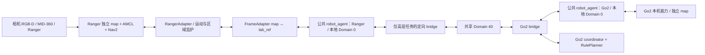

# Ranger 协同导航架构修改方案（2026-10-09）

**本文件是实施计划，不是已实现/已测试状态。** 本轮到两份文档交付结束，不据本计划执行构建、启节点、bridge或真机运动。基线为 `/home/isee601/ws/VLM_Nav`，`main@251f9fb39c25849dac00e81aec97fa5c45d98c1d`，含用户原有6项未暂存修改。证据、行号、地图哈希、外部工作区和限制见[本机核查报告](../../multi_agent/ranger_code_audit.md)。以下路径无绝对前缀时均相对该仓库；“新增”均指后续拟新增，本轮没有创建这些产品文件。

## 1. 决策与部署边界

沿用两个本地robot_agent；Go2部署唯一coordinator＋RulePlanner。Ranger仅提供RangerAdapter、公共agent的本机绑定、FrameAdapter、资源监护及本机定向bridge。不在Ranger启动另一个协调器，不添加global VLM planner或自动覆盖算法。首版使用经现场确认的人工观察点，coordinator保留既定 `decide(snapshot) → planned_actions` 规则调度扩展点。



图中lab_ref只用于通信边界数值转换，不把两台map/TF发布到共享网络。生产用lab_ref数值采用**指定Go2 map**；目前尚无指定地图正式身份与真实SE(2)，不能默认采用本机旧Go2候选或单位变换。状态、图像处理、路径和costmap均保持Ranger本机frame语义。

固定任务：Go2找A，Ranger找B；每次有效观察两端都检查ABC。双方自己的取物主任务READY后才使用同一个C；Go2先模拟放入并整机退出，coordinator确认后才给Ranger进入许可。可达性、停车点及整机退出由各自本机判断；共享物体线索身份和位置，不共享对方停车点作为执行目标。无机械取放接口证据，第一版“放入”是按公共任务定义的模拟技能，不声称存在机械臂。

## 2. 实施前依赖与同步合同（任务1）

现本机没有新公共包/接口源码，旧`multi_agent_msgs`亦仅见历史记录和bridge引用；`start_ranger_agent.sh`引用的`/home/isee601/ws/install/setup.bash`不存在。**尚未取得对端实现证据**，不能把Go2实施方案当已完成代码。

后续通过用户提供的本地代码包/明确授权的代码同步获取公共实现，先审阅，再绑定；本轮不SSH、pull或另造协议。约定的 `multi_agent_task_msgs/{AgentState,Observation,Command}` 只是应对齐的设计名，收到代码后逐一核实。

| 必须取得的材料 | 落地/通过标准 | 未取得时停在哪一步 |
|---|---|---|
| 公共源仓库/commit、源码和本地diff、依赖版本、许可证 | 文档登记commit、文件哈希、构建包名；两个本地agent同一兼容版本 | 不写公共import、enum、factory猜测，不构建agent绑定 |
| .msg/IDL、schema version、topic/type、QoS | 与Go2精确逐字段/类型比对，含坐标/身份/有效性/模拟标志 | 不创建Ranger私有ROS消息或第二套wire格式 |
| RobotAdapter真实签名、异步句柄/取消约定、robot_agent组装入口 | 按实际接口实现RangerAdapter，公共agent调度权不复制 | 只可做内部geometry/fake能力测试 |
| command去重/序号/ack/retry/有效期、heartbeat/掉线、READY/deposited/恢复规则 | 双端共识；已有实现欠缺语义时回公共源修订并统一版本 | 不以“消息收到”代替执行完成，不独立新增不兼容字段 |
| resource申请/授予/撤销/退出确认语义、唯一coordinator身份 | 允许表达持有者、任务身份与共同resource_id；终止/掉线不自动释放占用 | live门/C任务禁止 |
| 指定Go2 map ID、版本/hash、lab_ref定义、场景资源/目标目录 | lab_ref数值与Go2 map精确对应；双方scene/alignment版本一致 | live跨图动作禁止 |

需核对的**语义覆盖**至少包括schema_version、task_id、robot/recipient、command/goal/observation身份、本机地图ID/版本、common_frame_id、alignment_id、simulation，以及position_valid、ready/deposited、健康/停机/资源状态。这里不规定字段类型/enum/新话题；若已有协议不能表达要求，记录差距，在公共实现中统一修订后再接入。旧里程计state保持兼容，不改类型，不把nav_state=IDLE当READY。

拟新增 `docs/multi_agent/protocol_sync.md`：登记公共包来源/commit、精确签名、消息/topic/QoS、差异、双方确认及场景版本。拟新增 `cooperative_deps/README.md`（目录由后续代码同步建立）：说明公共原版源码的本机暂存和来源，不fork重写coordinator。构建时显式列出源码根避免重复包。

验证（后续、只读源码）：

```bash
cd /home/isee601/ws/VLM_Nav
rg --files cooperative_deps -g package.xml -g '*.msg' -g '*.idl' -g '*adapter*.py' -g '*agent*.py'
rg -n 'RobotAdapter|AgentState|Observation|Command|QoS|ready|recipient|simulation' cooperative_deps
colcon list --base-paths /home/isee601/ws/VLM_Nav /home/isee601/ws/VLM_Nav/cooperative_deps
```

预期：实际公共包、签名可见，每个包名只出现一次；缺包即失败，不能以旧`multi_agent_msgs`顶替新任务包。本轮没有执行这些命令。回退：未绑定公共agent前继续旧单机入口，无需改变工作区分支。

## 3. 精确文件清单

公共包未取得，公共源的内部文件名不能预先编造。下面固定Ranger侧路径；公共依赖只同步原版，对其修改如确有必要须记入任务1的共用变更清单。

| 路径 | 状态 | 职责/最小修改 |
|---|---|---|
| `vlm_nav/cooperative/__init__.py` | 新增 | 本机能力模块，不定义公共wire协议 |
| `vlm_nav/cooperative/frame_adapter.py` | 新增 | SE(2)正逆、点/yaw/polygon、地图身份/标定版本门槛 |
| `vlm_nav/cooperative/perception.py` | 新增 | RGB-D snapshot、图像时刻TF、同帧ABC异步识别、分目标tracker和结果有效性 |
| `vlm_nav/cooperative/motion.py` | 新增 | ComputePath/Navigation/Spin异步句柄、结果身份、规划与执行拆分、取消和停稳 |
| `vlm_nav/cooperative/ranger_adapter.py` | 新增 | 实现同步到的真实公共RobotAdapter；本机选停车点/可达性、技能串行、模拟放入 |
| `vlm_nav/cooperative/resource_monitor.py` | 新增 | 路径/重规划、地图位姿、footprint与门/C区域；公共许可绑定/整机退出 |
| `vlm_nav/cooperative/velocity_gate.py` | 新增 | 本机速度门控；锁定时持续零，解锁需有效本机执行许可与健康；输入过期锁定 |
| `vlm_nav/cooperative/agent_entry.py` | 新增 | 组装原版robot_agent＋RangerAdapter；不另写robot_agent状态机/协调器 |
| `scripts/ranger_robot_agent`、`scripts/ranger_velocity_gate` | 新增 | env python3可执行wrapper，调用以上entry；由CMake安装到lib/vlm_nav |
| `config/cooperative/robot_ranger.yaml` | 新增 | 本机技能topic/action、stop反馈源、footprint引用、默认motion_enabled=false；公共参数名以同步结果为准 |
| `config/cooperative/alignment_ranger_lab_ref.yaml` | 新增 | live标定元数据，validated=false，未取得的变换值为空/显式缺失，加载器拒绝live |
| `config/cooperative/scene_lab_ref.yaml` | 新增 | ABC描述/实例、人工观察/等待/退出点、门/C polygons与resource_id，未测值缺失 |
| `config/cooperative/nav2_ranger.yaml` | 新增 | 固定map+动态obstacle/voxel层、Ranger尺寸、独立停车容差与受控BT；不改旧AMCL profile |
| `config/cooperative/bridge_ranger_tasks.yaml` | 新增 | 仅新任务高层topic定向0↔40，类型/QoS取真实公共包 |
| `config/cooperative/dds_ranger_local.xml`、`config/cooperative/dds_ranger_bridge.xml` | 新增（任务6版本验证后） | 实际可用RMW的发现/传输隔离；不先写未经支持的按域XML规则 |
| `behavior_trees/ranger_cooperative.xml` | 新增 | Nav2重规划/控制；禁用可能绕开许可的盲目backup/恢复运动，恢复动作也必须受门控与资源监护 |
| `launch/ranger_cooperative.launch.py` | 新增 | 本地agent/gate/系统组合，固定AMCL，禁止旧自主节点、默认不运动，不启coordinator/bridge/硬件 |
| `launch/ranger_cooperative_base.launch.py` | 新增 | Ranger本机底盘Node，复用已读ranger_base参数，关闭odom TF，`/cmd_vel`订阅remap到gate输出 |
| `scripts/start_ranger_cooperative.sh` | 新增 | 新主入口，显式配置/overlay/DDS、预检、attach受控本机栈，默认禁运动；不自动跨端桥接 |
| `scripts/start_ranger_cooperative_hardware.sh` | 新增 | 后续独立冷启动入口，复用01/03/04；02替换为gated base launch，检查重复驱动，缺配置拒启 |
| `scripts/start_ranger_task_bridge.sh` | 新增 | 独立新bridge入口，校验版本/类型/方向/DDS隔离，保留本机已确认环境，不unset隔离配置 |
| `launch/system.launch.py` | 修改 | 新增legacy节点开关（默认true）及Nav2 overrides透传（默认空）；原默认行为保持 |
| `launch/vlm_navigation.launch.py` | 修改 | 新增`start_legacy_navigator`（默认true），仅对原vlm_navigator Node加IfCondition；适配/过滤/原TF仍可复用 |
| `CMakeLists.txt` | 修改 | 在现PROGRAMS安装区63–67加入2个wrapper；注册新测试，launch/config/BT现目录安装规则已覆盖 |
| `package.xml` | 修改 | 在同步后声明真实公共agent/消息依赖；bridge若仅shell工具则按实际运行依赖声明，不添加Go2硬件依赖 |
| `.gitignore` | 修改 | 明确忽略`/build_cooperative/`、`/install_cooperative/`、`/log_cooperative/`、公共源码暂存`/cooperative_deps/`（来源记录保留在docs） |
| `README.md` | 修改 | 增加新协同/旧单机入口与前置条件，保留用户已有路径和说明 |
| `docs/multi_agent/protocol_sync.md`、`docs/multi_agent/ranger_cooperative_runbook.md` | 新增 | 公共对齐证据、配置身份、分级验收和回退操作 |
| `test/cooperative/conftest.py`、`test/cooperative/fakes.py` | 新增 | 纯Python依赖注入、假能力/时钟/公共消息fixture；不rclpy.init、不创建真ActionClient |
| `test/cooperative/test_protocol_binding.py`、`test_frame_adapter.py`、`test_perception.py`、`test_motion.py`、`test_agent_integration.py`、`test_resource_monitor.py`、`test_startup_config.py` | 新增，均在`test/cooperative/` | 任务1～7的故障/身份/方向/停止行为测试 |
| `test/cooperative/fixtures/alignment_synthetic.yaml`、`scene_synthetic.yaml` | 新增 | 仅synthetic非零平移/旋转和fake区域，simulation=true；不能复制到live配置 |

本方案不要求修改 `vlm_nav/vlm_navigator.py`、`geometry.py`、`models.py`、`latest_frame_worker.py`、旧Nav2/robot配置或外部驱动代码。新模块调用已有纯函数/worker，按已读RGB-D和action语义建立薄接口，不让新agent继承并运行整个VLMNavigator。若实施中必须抽取共享函数，先提出精确差异和旧测试证据，避免无关重构/依赖升级。

## 4. Ranger 坐标与配置（任务2）

新增frame_adapter和上述3个live YAML；输入为Ranger map下pose/物体point/polygon或公共lab_ref线索，输出在相应另一frame。传输前/接收后各转换一次：

```text
p_lab = R(theta) p_ranger + t
p_ranger = R(theta)^T (p_lab - t)
yaw_lab = wrap(yaw_ranger + theta)
yaw_ranger = wrap(yaw_lab - theta)
```

polygon逐顶点同样转换，footprint先按机器人本机yaw/pose放到map再与本机区域相交。SE(2)不证明高度对齐；物体z如公共协议需要则明确高度参考，未验证不生成跨图3D语义。协方差如存在按Jacobian转换并增加标定不确定性，不复制未变换协方差。

最小步骤：

1. Ranger map指定当前验收文件 `shared_maps/lab_ranger_20261006/lab.yaml`，记录YAML+image的审计哈希、resolution/origin、map frame和本地map_id/version；修改地图即使同名也变版本。加载时用现`fixed_map.validate_map_yaml`，比对真实`/map`元数据与配置。
2. 取得指定Go2地图文件/校验值、lab_ref身份及场景版本。本机`lab_rear120_20261001_IwQjMX`仅候选，不批准它为live lab_ref。
3. 由两图共同实测地标求Ranger→lab_ref刚体变换，保存地标、单位、方向、测量日期/操作者、拟合残差和独立检查点误差。拒绝镜像、比例不一致/非刚体差异；现场偏差超预算则重标，不能以YAML origin代替标定。
4. `validated=false`保持到实测验证；缺t/theta是配置错误，不默认为0。synthetic夹具允许非零平移与旋转，但simulation=true且与生产topic/发现范围隔离。
5. alignment记录Ranger map版本、common Go2 map版本、alignment_id、scene版本；协议输入检查recipient/task/坐标身份和有效期。frame_id同为map不是校验通过依据。
6. 发送本机位姿/物体位置先转lab_ref；接收Go2的B或C先转回map，本机规划停车点。坐标未validated时可报健康状态/无可导航位置的识别线索，拒绝跨图坐标任务；不把Ranger数值标成lab_ref。
7. TF新鲜度、AMCL协方差与map→odom跳变另作运行健康门槛，阈值来自定位/制动现场预算，缺值阻止live。fresh `/odom`不能替代map定位。

验证命令（后续）：`PYTEST_DISABLE_PLUGIN_AUTOLOAD=1 PYTHONPATH=. python3 -m pytest -q test/cooperative/test_frame_adapter.py`。预期点/yaw/区域正逆误差≤1e-9（仅合成数值测试）、单位/有限值/版本/反射检查通过；未validated或旧alignment拒绝live而不影响fake逻辑。现场标定的误差上限按区域安全余量明确填写，不能把合成精度当实物精度。回退：新配置不加载，旧map不改。

## 5. RangerAdapter 技能与薄接口（任务3）

下面第一列是**能力名称**，不是声称公共类已存在这些方法。真正方法名、参数、结果/取消handle类型由任务1写入protocol_sync后实现。Ranger内部每次操作保留task/command/goal或scan/observation身份、操作epoch、地图/alignment版本、是否simulation；ROS action UUID与公共逻辑goal_id同时保存，不能用kind字符串区分完成条件。

| 能力 | 已存在真实入口 | 本次新增薄接口的输入、输出、异步规则 |
|---|---|---|
| 本机位姿/健康 | `VLMNavigator.robot_pose:1744`的TF查询语义；AMCL配置，底盘`/odom` | motion/perception读取map←base_link与freshness；map pose供规划，底盘twist供经验证的停稳，保留各自frame |
| 固定视角ABC观察 | `OpenAICompatibleVLMClient.infer(rgb,target)`、`FrameSnapshot`、`LatestFrameWorker` | perception固定一个snapshot，对ABC描述各调infer；三个有界worker各有独立client/raw_response，每路只submit一次；共享图像sequence但分别绑定目标/结果身份、有效期和tracker，全部完成/超时后才推进视角 |
| RGB-D/投影 | `on_rgbd:1147`、`resolve_pending_rgbd:1218`算法；`depth_at_pixel_with_reason`、`project_pixel` | 建立可独立运行的捕获/投影薄层，仍按图像stamp查TF、RGB/depth/K同尺寸，禁止latest TF替代；输出object point(map)或position_valid=false |
| 旋转扫描 | `scan_yaws`、`begin_scan:1764`、`send_spin:2727`、`prepare_stationary_observation:1797` | motion发Nav2 Spin，每次terminal且有效反馈停稳后取新帧；perception完成同帧ABC才下一yaw。scan cancel使整批epoch失效，不直接发非零扫描速度 |
| 深度恢复 | `target_relative_bearing:1827`、`build_target_probe_candidates:1843`、`recover_target_depth:1925` | 移交调度权：返回观察动作候选，经本机规划/许可才执行；线索没有几何位置时不输出可导航物体坐标 |
| 路径/可达性 | `/compute_path_to_pose` ComputePathToPose；`request_next_plan:2447`、`on_plan_result:2468` | motion只规划并返回原始Path(frame/时间/身份)及成功状态，不立即navigate；失败/空path/错frame拒绝；停车候选由本机costmap＋footprint＋Native Nav2验证 |
| 取物/接近停车 | 旧`navigation_tick:2191`/`plan_then_navigate:2378`可借鉴目标投影与原生规划 | ranger_adapter保持object point与parking pose分离，生成本机候选，校验endpoint/物体距离/朝向/整机空间，排序后尝试路径；收到Go2停车点只作背景，不直接执行 |
| 导航/反馈 | `/navigate_to_pose`、`send_navigation_goal:2706`、`on_goal_response:2747` | 许可检查成功才发PoseStamped(map)，绑定action UUID、注册feedback，保存terminal原始status；巡检/等待/取物/放入/退出分别区分 |
| 取消/停止 | `cancel_motion:2885`、`request_approach_cancel:2266`、`advance_approach_stop:2316` | motion保留handle直到terminal；读取cancel return_code/goals_canceling，pending acceptance晚到立即取消；gate锁定，验证鲜活底盘速度/连续停稳。只确认cancel ack不能返回已停止 |
| 模拟放入 | 现仓库无接口 | ranger_adapter按公共模拟技能签名，在同一个C、许可/接近条件及停稳成立后执行带command身份的模拟完成；非simulation任务中的“模拟取放”语义须与Go2共同确认 |
| 退出/许可释放 | 无已有技能 | resource_monitor结合本机Path、map pose、footprint；退出Nav2成功仅作证据之一，整机与区域不相交/定位有效后才报告退出，公共coordinator最终放行下一台 |

停车策略必须与本机Nav2成功语义一致。旧planner容差0.76/controller0.05围绕物体参考点的成功机制不直接搬给协同：新增profile针对**本机选定parking pose**设置经验证的容差，要求真实action STATUS_SUCCEEDED且停稳/接近验收满足。若只能通过主动cancel停止，则回报取消/接近未完成，不能伪造action成功或READY。接近半径不是随意新数字，先将原0.81m作为单机背景，再由任务定义/整机尺寸/现场检验决定协同停靠条件。

API慢时心跳/取消/监护保持响应；后台任务有界，过期、已取消、旧scan/target/alignment结果丢弃，先校验身份再记当前任务的API错误计数。不能把一个LatestFrameWorker用于ABC三个独立submit而导致latest覆盖漏项，也不能共享client.last_raw_response产生结果串扰。三路请求的时间预算/CPU/网络负荷须测量，超时或过龄的目标记录未知并保持视角或重取完整新帧，不默默漏检或凭空延长有效期。识别区分未检出、不确定、API错误、识别但位置无效；当前VLMResult没有独立uncertain字段，使用confidence/匹配证据映射到公共真实语义，API错误不当“没看见”。ROS命令/心跳与资源监护使用独立callback group及明确锁/事件队列，VLM调用在worker中；action服务器可用性用非阻塞检查或独立有限等待，不能在监护回调中串行等待API/取消完成。

验证（后续）：

```bash
PYTEST_DISABLE_PLUGIN_AUTOLOAD=1 PYTHONPATH=. python3 -m pytest -q \
  test/cooperative/test_perception.py test/cooperative/test_motion.py
```

预期ABC同帧3结果完整、缺深度不发goal；慢API期间fake heartbeat/暂停照常；取消accepted但尚未terminal/未停稳时替换请求被阻止；pending晚到、旧task/goal成功均不起作用。没有任何真实ROS客户端/速度输出。回退：新adapter不启动，原VLM节点/参数保持现行为。

## 6. agent接入、READY与停用旧任务（任务4）

新增agent_entry/ranger_adapter，依赖原版公共robot_agent；不将整段旧VLM自主循环包装成黑盒技能。新增launch开关默认保持单机原行为，但**新协同launch强制 `start_legacy_navigator=false`**，不创建`/vlm_nav`旧任务节点；保留TF/FAST-LIO适配/filter/map/Nav2。新入口用`motion_enabled=false`启动，公共agent收消息/发健康状态，但不执行运动，必须后续明确使能且通过live门槛。

关键改点：`system.launch.py:34,42` 透传Nav2 profile和legacy开关；`vlm_navigation.launch.py:65` 的旧Node加IfCondition。不要仅用enabled=false充当“感知模式”，因为旧on_rgbd也被禁止；新perception独立处理图像。`scripts/arm.sh`继续服务旧单机，不用于使能协同agent。

公共agent负责命令recipient/授权来源校验、去重与串行调度，adapter只执行一个可取消技能。每个step与当前task/command/goal等身份绑定；重复消息回报相同执行状态，不再次运动。重启丢失执行上下文时恢复DISARMED并向coordinator同步，不从残留ready文件或旧心跳推断新任务已完成。公共实现如无所需持久化/重启规则，先统一修订，不能Ranger单方面恢复许可。

| 逻辑阶段（按公共enum实际映射） | Ranger条件与动作 | 责任与不能触发的捷径 |
|---|---|---|
| 空闲/未使能 | ready=false、deposited=false，配置可用仍不运动 | 本机健康报告可运行 |
| 查找/观察 | 固定找B，每次观察检查ABC；A/C线索可上报/缓存 | 不自主把C提升成当前主任务 |
| B接近 | 当前task有效、B几何有效、坐标版本匹配、本机parking/path可达、相关许可有效 | 收到Go2的B需先转换回map并本机选停车点 |
| READY等待 | **当前自身B取物主任务**的Nav2 STATUS_SUCCEEDED＋接近条件＋实际停稳；立即发ready并随心跳保持 | 观察/等待点/过门goal、Spin成功、旧goal、C线索、单机SUCCEEDED字符串都不置READY |
| 双方屏障完成 | Go2唯一coordinator确认两台真实robot的同一task READY与健康 | fake/simulation peer、失联或旧task不能参与live屏障 |
| C等待 | coordinator绑定同一C observation/实例身份；Go2先放入/整机退出 | Ranger保持ready，不因仅Go2 deposited或出口goal成功就进入 |
| Ranger进入/模拟放入 | 当前C许可有效、本机可达/停稳；模拟技能完成才置deposited | deposited不等于资源已释放 |
| Ranger退出 | 退出goal结果＋鲜活map pose、整机footprint确实不相交，再报告退出 | coordinator接收到匹配证据才释放/调度；定位无效不能推断退出 |
| 暂停/取消/失联 | gate锁定，取消与停稳完整确认；保留资源占用/不进入下一阶段 | READY等待的普通暂停不抹去已完成ready；整任务终止/换task按公共协议失效旧ready，禁止继续屏障 |

扫描、导航和Nav2恢复动作都经过同一本机motion串行控制与gate。旧自主节点、遥控、手动RViz导航goal发起者不能同时拥有运动权；后续启动预检需拒绝重复节点/底盘驱动/无门控消费者，现场使能前记录动作发起者。不能仅凭topic namespace保证唯一拥有权。

验证：`PYTEST_DISABLE_PLUGIN_AUTOLOAD=1 PYTHONPATH=. python3 -m pytest -q test/cooperative/test_agent_integration.py test/cooperative/test_startup_config.py`。预期READY矩阵、重复/晚到/换task/失联均满足上表；新launch无旧vlm_navigator和coordinator，旧launch默认开关=true；默认任何command不导致fake运动，显式使能与门槛齐全才可调用。回退见§11。

## 7. 资源与运动监护（任务5）

新增resource_monitor/velocity_gate/受控底盘launch，配置路径、速度、footprint和场景共同resource_id。门与C接近/放入区域均使用双方一致的ID/polygon版本，具体名字和坐标待场景资料确认，不从两图分别创造两个互不相知的门资源。

最小实现顺序：

1. 输入：ComputePathToPose返回Path、执行中最新重规划Path、map pose及健康、有效整机footprint、公共许可/command身份。初次path返回后先检查区域交叉并申请许可，获准前不发执行goal。
2. 本机现`/plan`仅有RViz/历史线索，现场确认planner真实更新话题、来源、QoS和header frame/time后写配置。`NavigateToPose`反馈不含path，Marker不作来源。重规划更新绑定当前执行goal/epoch，无法确认归属/过期则锁定；不能用规划前一次path代替全程更新。
3. 检查**整段扫掠footprint**与区域相交，含姿态变化/扫描旋转，不只检查路径中心线。用padding、定位/标定误差和实测制动距离膨胀区域，停止余量至少覆盖速度×检测/通信/取消延迟及制动、定位误差；现场预算缺失禁止live资源进入。
4. 持续监护实际机身边界、实际path及重规划。新path跨未授权区域：先gate锁定，在区域外保留足够停止余量，再取消/申请，获新许可且停稳后重新规划执行。距离边界不足或定位跳变不能“边走边申请”。
5. 公共许可不得因超时/失联自动让另一台进入仍可能被占用的区。定位无效、heartbeat丢失、机身仍在区内时报告占用不确定/暂停；coordinator保持锁，须现场确认/公共恢复流程后继续。
6. 退出判断使用Ranger实际有效整机轮廓，当前矩形±0.36/±0.25和padding0.03仅配置基线，附件/雷达支架突出待量测。退出Nav2成功但footprint仍触区，不释放；连续fresh证据与误差裕度满足后报告。C许可释放必须同时满足放入完成＋整机退出。
7. 使用新独立Nav2 profile：保留AMCL静态map，显式加入本机点云obstacle/voxel层；参数参考`config/nav2_overrides.yaml`而非照搬Go2。未现场确认另一台机身动态可见前，双机近距离/窄门/C不验收通过。
8. gate输入沿用本机Nav2输出`/cmd_vel`；**拟新增**输出`/ranger/cooperative/cmd_vel`，gated base launch将驱动绝对`/cmd_vel` remap到该输出。这是本机内部新接口，不是公共跨端topic。Nav2/controller/smoother/behavior均只能经该gate到驱动；锁定时忽略上游非零、持续零速，输入超时/许可失效/监护失效锁定。不得启动旧02驱动再并行启动gated驱动；attach到驱动仍监听原`/cmd_vel`时拒绝live。
9. 停稳用验证过的`/odom.twist`，结合map位移/反馈证据，不用`/fastlio/odom`未经填充的twist或命令零值当测量。gate进程崩溃/最后非零输出后的底盘停机时间不能由ROS代码推断；必须验固件watchdog或已确认的独立本机watchdog。在证据缺失时不放行live使能。

取消生命期为：使操作epoch无效→锁gate→向已接受goal发cancel→等待cancel响应并保存pending handle→等待对应action terminal→鲜活有效速度连续停稳→才完成cancel并允许替换。响应码不接受/超时、future异常、速度过期保持锁定/故障；cancel后的晚到STATUS_SUCCEEDED不置READY/deposited。对Go2整机退出的证据与其adapter实现需任务1交接确认，Ranger不臆测对端已支持。

验证：`PYTEST_DISABLE_PLUGIN_AUTOLOAD=1 PYTHONPATH=. python3 -m pytest -q test/cooperative/test_resource_monitor.py test/cooperative/test_motion.py`。预期出口goal成功但车尾在区内不释放；有旋转的footprint/路径跨区能发现；重规划进未许可区先锁定；定位/速度无效或断联不释放；一方只能申请，同一resource_id没有两个有效holder。gate的失效默认锁定、非零覆盖防护通过。回退不强制释放资源，先核实实体已停车、整机位置与共同占用状态，再撤协同入口。

## 8. 新启动链、构建与定向桥接（任务6）

### 8.1 启动与overlay

新增入口使用绝对本机REPO及传入的live配置；source次序为Humble、当前5个已确认硬件/VLM overlay，最后新增`/home/isee601/ws/VLM_Nav/install_cooperative/setup.bash`。后者覆盖同名vlm_nav，公共包从同一构建输出导入。打印包前缀/协议版本但不打印key/env全集；缺公共包/地图/门槛明示失败，不能继续进入live使能。

```text
后续分阶段启动（均未执行）
start_ranger_cooperative_hardware.sh
 ├─ 显式本机Domain0发现隔离（相机/雷达/底盘/LIO全链）
 ├─ 01_camera.sh + 03_livox.sh + 04_fastlio.sh（复用真实脚本）
 └─ ranger_cooperative_base.launch.py（独占底盘、关闭odom TF、受gate输出控制）
start_ranger_cooperative.sh --map <Ranger map> --config <本机配置>
 └─ ranger_cooperative.launch.py（默认motion_enabled=false）
     ├─ system.launch.py localization_mode:=amcl start_legacy_navigator:=false
     │                   nav2_overrides_file:=<独立协同profile>
     ├─ ranger_velocity_gate（默认锁定）
     └─ ranger_robot_agent → 公共agent factory + RangerAdapter/FrameAdapter/monitor
start_ranger_task_bridge.sh（DDS隔离验收后单独启动）
 └─ 实际取得的domain_bridge + 高层task allowlist（0↔40）
```

硬件入口只准备本机，不自动bridge/使能；新主入口默认attach，拒绝旧自主节点/重复底盘/错误速度接收接口。完整冷启动后初始化Ranger独立地图定位，先状态/感知验收，再按公共实际接口使能运动。若硬件已有运行，不在脚本里擅自重启/杀进程，列出冲突并按现场安排处理。

### 8.2 域与DDS依据

采用后续目标Domain0↔40：依据当前旧agent显式Domain0、旧bridge YAML from0/to40及本次较新要求。早期30↔40↔31在本机未见生效配置；本轮不变域。单机common未设Domain，后续新入口须对所有本机节点明确0和一致发现策略，不能只agent是0。

现有wlo1只被脚本检查，不能证明DDS绑定；本机已安装FastDDS，未找到Cyclone或domain_bridge。新DDS XML须以取得的真实bridge/RMW版本支持为准：要求本机0 participant仅本机可发现，共享40 participant仅经Ranger已确认共享接口发现，禁止0无线直连对端。不要将Go2网卡/IP带入本机，不改MID-360有线配置/路由。

实施任务6先验证bridge是否支持不同domain participant的发现/传输策略，再写上述两个XML和加载方法并记录schema/版本。若单进程只能统一限制且无法同时满足0隔离与40可达，则该部署方式未通过，需与公共bridge实现共同确定可支持的participant隔离方案；保留Domain0/40设计、禁止live bridge，不私自换30/31或发明新传输协议。`ROS_LOCALHOST_ONLY=1`对整个bridge、unset profile或namespace均不能当通过证据。

### 8.3 路由对照

当前旧YAML只2个旧state（best_effort/volatile/depth1），保持文件和消费者兼容。新task bridge独立，不覆盖旧YAML/脚本，避免旧state误入READY。目标名称来自提供说明，最终逐项替换为Go2公共实际topic/type/QoS；不创建另一组同义topic。

| 目标高层topic（待公共确认） | Ranger本地/共享方向 | 真实类型与QoS的填写规则 |
|---|---|---|
| `/multi_agent/ranger/state` | 0→40 | 任务版AgentState，包名/字段/QoS由公共包确认 |
| `/multi_agent/ranger/observation` | 0→40 | 任务版Observation，同上 |
| `/multi_agent/go2/state` | 40→0 | 任务版AgentState，同上 |
| `/multi_agent/go2/observation` | 40→0 | 任务版Observation，同上 |
| `/multi_agent/go2/command` | 40→0 | 任务版Command，按recipient过滤；名称不表示只给Go2，不自行改成ranger/command |

在domain_bridge实际YAML中每topic只有一个源方向（反向路由仅来源40的项），禁止双方同topic双向回灌。命令必须具有公共ack/去重/有效期语义；QoS匹配publisher/subscriber，不能把旧best_effort/depth1直接复制给任务命令，也不猜一个“可靠”配置就认为业务可靠。心跳超时按本机接收单调时间，跨机消息时间龄的判断须有同步依据，未知时不把两端monotonic值相减。

**明确不桥接** `/tf`、`/tf_static`、`/map`、`/scan`、任何点云/IMU/图像、`/odom`/`/fastlio/odom`、速度/本机gate接口、Nav2 action/service、真实执行path/costmap。DDS直通泄漏也属于失败，而不只检查bridge配置没有这些topic。

### 8.4 后续构建验证命令

以下只在代码实现和依赖同步之后运行；路径为拟建的本机隔离构建输出，不是当前已有公共install。

```bash
cd /home/isee601/ws/VLM_Nav
source /opt/ros/humble/setup.bash
source /home/isee601/ros2_ws/install/setup.bash
source /home/isee601/rs515/ros2_ws/install/setup.bash
source /home/isee601/agilex_ws/install/setup.bash
source /home/isee601/ws/install_fastlio/setup.bash
source /home/isee601/ws/VLM_Nav/install/setup.bash
colcon list --base-paths /home/isee601/ws/VLM_Nav /home/isee601/ws/VLM_Nav/cooperative_deps
colcon --log-base /home/isee601/ws/VLM_Nav/log_cooperative build \
  --base-paths /home/isee601/ws/VLM_Nav /home/isee601/ws/VLM_Nav/cooperative_deps \
  --build-base /home/isee601/ws/VLM_Nav/build_cooperative \
  --install-base /home/isee601/ws/VLM_Nav/install_cooperative \
  --symlink-install --packages-up-to vlm_nav
source /home/isee601/ws/VLM_Nav/install_cooperative/setup.bash
ros2 pkg prefix vlm_nav
ros2 pkg executables vlm_nav
bash -n scripts/start_ranger_cooperative.sh scripts/start_ranger_cooperative_hardware.sh scripts/start_ranger_task_bridge.sh
PYTEST_DISABLE_PLUGIN_AUTOLOAD=1 PYTHONPATH=. python3 -m pytest -q test/cooperative/test_startup_config.py
```

`--packages-up-to vlm_nav`以package.xml依赖使真实公共包纳入；如果公共代码分开提供非依赖构建包，任务1依据colcon list明确加入其真实名字，不以编造包名替代。预期无重复包、编译成功，vlm_nav前缀是install_cooperative/vlm_nav，2个新wrapper可见，shell语法通过，静态检查无旧VLM节点/协调器/底层桥接。不要直接运行`--show-args`来当纯静态检查：本仓库OpaqueFunction可能读取配置/写临时文件，launch验证方式先审阅实际行为。

回退：source旧`VLM_Nav/install`、不启动新入口，保留旧build/install不覆盖。新DDS环境限定新协同终端/进程；恢复单机时使用原单机环境，不让新隔离profile残留混入。

## 9. 离线/fake验证（任务7）

新增test/cooperative上述文件，依赖公共已同步schema用于binding测试，纯Pythonfakes用于内部几何/状态/时钟。不得创建真实ActionClient/Publisher，不能通过namespace把旧绝对话题包装成mock。若后续确需ROS集成fake，另审阅公共fake启动器：独立测试域/发现限制、显式重映射所有绝对topic/action、simulation=true、禁Nav2/底盘硬件实例，且只能向公共测试topic，不与live屏障连通。

```bash
cd /home/isee601/ws/VLM_Nav
PYTEST_DISABLE_PLUGIN_AUTOLOAD=1 PYTHONPATH=. python3 -m pytest -q test/cooperative
```

通过标准：

| 必测场景 | 应有结果/对应测试 |
|---|---|
| 两图有非零旋转/平移、alignment变化 | frame_adapter正逆点/yaw/polygon正确，旧版本拒绝 |
| 识别成功但深度/TF/K/标定无效 | perception只发无导航位置线索，motion无goal |
| Go2发现B | 公共binding→转换Ranger map→本机候选；本机当前B主goal成功才READY |
| 观察/等待/过门成功，或旧本地SUCCEEDED | agent_integration不置READY |
| 重复command、goal pending后取消、旧goal晚到成功 | motion/agent只执行一次，不污染新task，不置READY/deposited |
| 同帧ABC与API超长等待/出错 | perception逐目标区分；agent heartbeat/暂停/监护不中断；旧批次失效 |
| cancel accepted但未terminal、实体未停/速度无效 | motion保持取消/锁gate，拒绝替换Scan/Nav |
| 只有一端READY、模拟对端READY、对端失联 | 公共agent/coordinator的离线契约测试不放行live C屏障 |
| Go2可达但Ranger不可达 | 本机planner拒绝候选，公共planner不得借Go2可达性放行 |
| Go2 deposited但未整机退出、出口成功仍触区 | C许可不放行，resource_monitor不释放 |
| 重规划跨新资源区、旋转footprint跨区、定位跳变 | 先锁定/取消，不无许可越界；失联不自动释放 |
| 启动域/桥方向/重复底盘/legacy开关 | startup_config拒绝泄漏/回灌/原cmd_vel消费者；default不运动 |

对coordinator的屏障/唯一资源holder测试应调用**收到的公共RulePlanner/测试fixture**，若没取得实现只能测试Ranger拒绝逻辑，不能宣称Go2屏障已通过。完整旧测试后续实现回归按任务影响选择：launch/config变更需旧fixed_map/easy_case/obstacle配置测试；公共几何未改不无故重构或升级。现`test_no_hardware.sh`包含ROSruntime测试，运行前审阅隔离和是否启动节点，不在本轮执行。

回退：移除新入口的运行选择，旧测试/旧单机能力仍可使用；fake产物与live配置不混用，不把测试READY发送到共享live域。

## 10. 现场分级验收与交接（任务8，均未执行）

每级记录本机源码/公共commit、dirty diff、实际package前缀、地图/scene/alignment/hash、RMW/bridge版本、参数快照、结果与失败原因。下面ROS命令会发现/读取现场节点，仅留作后续明确安排后的验证，不在本轮调用。运动命令通过公共真实接口和专用验收入口执行，签名未知时不写虚假send_goal坐标或cmd enum。

| 级别 | 前置条件/验证命令 | 通过标准 |
|---|---|---|
| 0：离线 | 任务1公共源码同步，任务7pytest、构建/静态launch检查 | 无真实速度/action/共享消息；兼容接口和故障矩阵通过 |
| 1：Ranger本机静止 | 后续运行新硬件/本机入口但motion_enabled=false；`ros2 node list`、`ros2 topic info -v /cmd_vel`、`ros2 topic info -v /ranger/cooperative/cmd_vel`、`ros2 param get /ranger_base_node publish_odom_tf` | 没有旧/vlm_nav/coordinator；底盘只订gate输出，gate默认锁定；无重复TF；实体不运动 |
| 1a：传感/定位 | `ros2 param get /map_server yaml_filename`、`ros2 param get /amcl robot_model_type`、`ros2 run tf2_ros tf2_echo map base_link`、`ros2 topic echo /camera/color/camera_info --once`、`ros2 topic info -v /camera/aligned_depth_to_color/image_raw` | Ranger map/hash正确；K/流尺寸/实际设备/图像TF与外参验证、定位不跳变；API逐帧ABC定位误差在预算内 |
| 1b：停止/路径/避障 | `ros2 topic echo /odom --once`、`ros2 topic echo /fastlio/odom --once`、`ros2 topic info -v /plan`、`ros2 param get /local_costmap/local_costmap plugins`、`ros2 param get /global_costmap/global_costmap plugins` | 对照受控运动证明速度有效，记录plan实际来源/QoS/更新；协同动态层确实生效。取消ack后继续运动、gate崩溃/watchdog/断流、Nav2 recovery均有停车证据 |
| 2：仅跨端高层消息 | 任务6 DDS版本/发现隔离配置可用，两端默认禁运动；后续单独启动task bridges；分别在本机0/共享40 `ros2 topic list -t`、对公共实际topic `ros2 topic info -v` | 只有allowlist高层状态/观察/命令跨端；0无对方map/TF/Nav2/速度，40无底层泄漏；recipient/来源、QoS、往返唯一/断联暂停通过 |
| 3：共享B/C几何与本机单独适配运动 | 指定Go2 map/SE(2)经真实地标与独立点验证；任务/候选身份正确；本机正常导航、取消停稳和速度门控验收 | Go2线索转换后Ranger停车点由本机选择；位置无效/不可达拒绝；当前B Nav2真实成功才READY；取消晚到不污染 |
| 4：真实屏障和同一C顺序 | 两端公共实际实现/版本均验收、fake完全隔离；Go2本机footprint退出监护有证据；共同scene/许可一致 | 一端READY不放行；双方真实READY同task才推进；同C身份唯一；Go2放入且整机退出才放行Ranger |
| 5：窄门/C完整流程 | 动态障碍对方机身可见、整机尺寸/定位/标定/制动余量已测；每端本机路径和退出有效 | 无许可不进入；重规划/定位无效/断联安全暂停且资源不误释放；Ranger放入置deposited、整机退出后释放 |

第1级需测相机实体型号，不以L515历史记录替代；需确认底盘反馈速度、固件watchdog与附件轮廓。第2级先验发现隔离，再启共享通信；本轮的interface列表不证明wlo1正确IP/绑定。第3级前填写SE(2) live validated标记，不能用synthetic标定。第4/5级不能根据Go2历史方案或只收到一个state声称完成。

现场仍需补齐ABC精确描述及各实例、指定Go2 map身份、标定地标/误差、门/C/等待/退出区域、共享接口/DDS支持、公共包schema/factory/取消/许可/恢复合同；缺口按核查报告§7阻塞相应级别，不阻止本轮文档交付。

## 11. 旧单机回退入口

保留现`start_fixed_map_navigation.sh`、`start_navigation_validation.sh`、`arm.sh`、`stop.sh`及旧固定地图profile。新两个launch参数默认值确保现脚本行为不变；不通过reset/切分支覆盖用户改动。新公共源码/构建输出与旧install分开。

后续回退先由当时现场操作安排确认：停止推进、gate锁定、取消到terminal、有效速度停稳、实体资源占用与coordinator记录核实；失联/仍在区内不能为回退而虚报退出。随后退出仅新协同agent/bridge/gate/受控底盘入口，恢复原单机环境/驱动。若采用已有底层栈，依据实际topic接收接口处理，不并行启动第二个底盘驱动。

下列是**旧单机已存在入口**（本轮只记载，未执行）：

```bash
cd /home/isee601/ws/VLM_Nav
./scripts/start_fixed_map_navigation.sh \
  --map /home/isee601/ws/VLM_Nav/shared_maps/lab_ranger_20261006/lab.yaml \
  "红色灭火器"
# 原操作：RViz初始定位、原系统检查，然后按现场安排 ./scripts/arm.sh
# 原停止入口：./scripts/stop.sh
```

旧stop是disabled＋零速，仍按已验收单机流程和现场反馈确认停车，不提升为新协同取消/资源释放证明。构建新版本不覆盖旧install；旧入口使用原`common.sh`五个overlay，新cooperative终端的DDS/overlay变量不带入回退终端。

## 12. 本轮交付与下一阶段门槛

本轮只新增审计报告及本计划。未修改上表任何产品文件，未构建/测试/运行/source启动脚本，未启真机或桥接，未做跨端通信或联合运动。新文件清单、接口映射、状态规则和验证路径是可审阅实施结果，不能解释为授权自动进入任务1～8。

下一阶段优先取得公共实现/交接及指定Go2 map；可在另行安排的实施阶段并行推进纯本机能力/合成几何验证，但涉及公共字段、agent绑定和bridge的工作必须在真实schema/接口确认后执行。现场配置缺口按级别门控，不填写猜测坐标或伪造validated=true来绕过。
