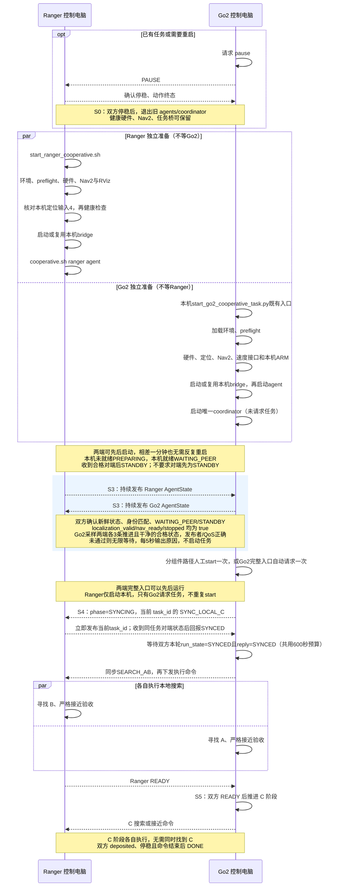

# 双机协同启动与验收

> 此文档原为一式两份, 此为ranger侧微调修改版本
>
> 更新日期2026.10.22

适用：双方独立地图、A/B 双方 READY 屏障、独立搜索和接近 C、无先后顺序、无 EXIT。本流程沿用 [Ranger 单机验收记录](协作Ranger单机验收.md) 的硬件与静止通信方法，覆盖该旧文第 4 节的共享坐标、保护区、Go2 先行和退出要求。

**两端独立启动，本机检查通过后由 agent 持续准备并等待对端。Ranger 全流程仅保留本机定位确认；Go2 完整入口在双方准备采样通过后请求一次任务。** 人工分组件路径仍可使用；真实双机任务尚待现场验收。

验证标志全部核实后的全流程脚本:

```
bash /home/isee601/ws/VLM_Nav/scripts/start_ranger_cooperative.sh
```

- 第 2、3 节核对两端实际配置和身份
- 第 4 节确认硬件/定位就绪
-  第 6 节保持或启动任务桥、重新加载 agent、确认双向 WAITING_PEER/STANDBY、启动唯一 coordinator
- 第 7 节由 Go2 完整入口自动请求一次；人工分组件路径才手工 start
-  第 8 节暂停/结束

  已正常运行的硬件和桥可复用；第 5 节 PAUSED 专用采样及停流试验不再重复，也不要关闭已核实标志来满足旧检查器。两端各自 preflight 通过后，仍需人工对照地图身份及运行中的状态，不能直接跳到 start。

## 1. 文件、终端与配置

- [Cooperative_env.bash](../Cooperative_env.bash)：每个终端加载本机现有 ROS/硬件/API 环境，最后选择新任务 overlay，并设置本地域 DDS。
- [cooperative.sh](../scripts/cooperative.sh)：按动作启动或检查单个组件，`--help` 不加载 ROS。
- [start_ranger_cooperative.sh](../scripts/start_ranger_cooperative.sh)：Ranger 本机全流程，串联第 3、4、6 节；只确认本机定位，随后自动启动本机组件并异步等待 Go2。
- [启动工具包](multi_agent/cooperative-startup-20261020.tar.gz)：旧快照，仅含环境文件、单组件命令、PAUSED 通信检查脚本及旧版本文，不含新增 Ranger 编排入口、密钥、实机配置或操作系统依赖。

| 电脑 | 仓库 | 本地域 | 共享域 |
|---|---|---|---|
| Ranger | `/home/isee601/ws/VLM_Nav` | Domain0，`lo` | Domain40，`wlo1` |
| Go2 | `/home/isee-pst/unitree_ros2/VLM_Nav` | Domain0，`enp4s0` | Domain40，`wlo1` |

旧记录中 Go2 Wi-Fi 为 `192.168.1.118`；本次只读查询 Ranger 为 `192.168.1.113`，不要照抄旧的 `.108/.111`。脚本依靠实际网卡/XML，不固定 Wi-Fi IP。两端各自开终端，不自动 SSH。Ranger 端不启动 coordinator。

2026-10-20 工具包只保留作历史记录，**不要用其旧脚本覆盖最终版本**。Go2 应按其本机最新 runbook 部署最终源码、启动工具和新的隔离 overlay；当前接口以 [ans_async_startup.md](multi_agent/ans_async_startup.md) 为准。Ranger 不通过 SSH 部署或启动 Go2。

不要使用旧 `start_ranger_agent.sh`/`start_go2_agent.sh` 代替任务 agent：它们是旧里程计状态转发链。旧 `start_ranger_multi_agent_bridge.sh` 也不是本流程的五话题任务桥。

## 2. 每个终端先加载环境

Ranger 的每个 R 终端执行：

```bash
source /home/isee601/ws/VLM_Nav/Cooperative_env.bash ranger
```

默认读取 `build/ranger-local/current-acceptance-run.txt` 指向的配置。当前是 `build/ranger-local/acceptance-20261015_161341/config`。需要其他现场副本时显式指定，后续脚本会沿用：

```bash
source /home/isee601/ws/VLM_Nav/Cooperative_env.bash ranger /实际/Ranger配置目录
```

Go2 的每个 G 终端先指定其本机已更新的隔离 overlay，再加载环境；安装路径按 Go2 本机最新 runbook 核实，不沿用旧默认目录：

```bash
export COOP_SETUP_FILE=/实际/最终版本overlay/install/local_setup.bash
source /home/isee-pst/unitree_ros2/VLM_Nav/Cooperative_env.bash go2 /实际/Go2配置目录
```

缺文件就停下，核对实际构建目录。不要为了通过检查而退回旧的顺序/EXIT 安装。Ranger 本轮已核对实际安装导入，33 个 Python 文件与源码一致，安装采用符号链接，无需重复构建这部分。其他安装情况可参照 [本机构建说明](multi_agent/ranger_local_runbook.md#环境和构建终端-a自动退出)。API 继续使用各电脑已配置的环境变量，不写入脚本，不打印密钥。

当前 Ranger 已配置场地 Keepout，使用人工多边形生成的独立掩膜，原定位地图不变。更新前的旧 Nav2/agent 须停稳后正常退出再加载；缺少 Keepout 三节点的旧导航不能复用。掩膜、候选过滤及三个静止验收步骤见[Keepout说明](multi_agent/ranger_keepout_20261022.md)。

### 2.1 Ranger 全流程启动入口

Ranger 在本机图形桌面终端执行：

```bash
bash /home/isee601/ws/VLM_Nav/scripts/start_ranger_cooperative.sh
```

默认使用当前验收配置。自定义配置先按第 2 节 source 指定目录，再运行同一命令。两端完整入口可以先后启动；Go2 继续使用本机 `scripts/start_go2_cooperative_task.py` 的既有参数和硬件顺序，不要求同时操作。

| 阶段 | Ranger 全流程自动执行的内容 | 操作者需要做的事 |
|---|---|---|
| 本机预检 | 检查安装/配置/协议，拒绝旧任务进程或重复桥 | 失败时按具体原因处理；不等待 Go2 在线 |
| 硬件和定位 | 调用既有硬件、Nav2、RViz和诊断入口，复用完整健康实例 | 在 RViz 核对真实位姿，必要时初始化定位；确认后输入 `4` |
| 本机健康检查 | 只读检查本机地图、定位、导航及输入 | 失败即停止后续启动 |
| 任务桥和 agent | 复用或启动唯一任务桥，启动唯一 Ranger agent | 无需确认 Go2 的 ARM、agent、coordinator 或其他步骤 |
| 显示和等待 | 打开 state/peer；主脚本退出，agent保持运行并持续准备/等待对端 | 保持组件终端运行，状态以实际消息为准 |

本机 `PREPARING` 表示自身输入或健康尚未满足；`WAITING_PEER` 表示本机已就绪正在等对端；收到合格对端后为 `STANDBY`。对端可以晚启动一分钟，不能因正常等待交替重启 agent。本机启动完成不代表双方通信、READY 或任务已经验收。

**准备采样与开始任务由 Go2 入口负责。** Go2 完整入口等待两端各3条推进、干净的新鲜 WAITING_PEER/STANDBY，校验唯一发布者及QoS，随后自动请求 start 一次。Ranger 全流程不再前台调用 `ranger wait`，避免 Go2 已经进入 SYNCING/执行阶段后，Ranger 仍等待无任务准备状态。Go2 完整入口已请求任务时，不重复手工 start。

若 Go2 使用人工分组件路径，先启动唯一 coordinator，在 Go2 运行 `cooperative.sh go2 wait`，通过后再执行第 7 节的一次手工 start。Ranger 的 `cooperative.sh ranger wait` 保留作**尚未请求任务时**的独立只读验收工具，不是本机全流程的前置屏障。

日志保存在验收目录 `cooperative-startup-日期_时间-随机后缀/`，含 `startup.log`、`preflight.json`、`health.log` 和新开终端的 `bridge.log`、`agent.log`、`state.log`、`peer.log`。复用桥的历史输出仍在原终端。`preparation.log` 不再由本机全流程生成；Go2 保存其入口的准备采样日志。

预检失败、定位确认 EOF/Ctrl+C、本机健康失败或新终端启动失败均停止后续启动。已打开的组件保持运行；state/peer 的 Ctrl+C 只退出显示，不暂停任务。重启入口前须先停稳并正常退出旧 agent；脚本不自动 kill、重启对端、启动 Ranger coordinator 或请求 start。

以下第 3、4、6 节保留为人工分组件启动和排障入口；与本节全流程二选一，同一组件不要重复启动。

## 3. 离线预检与两端身份对照（R0、G0，执行后退出）

R0：

```bash
source /home/isee601/ws/VLM_Nav/Cooperative_env.bash ranger
bash "$REPO/scripts/cooperative.sh" ranger preflight
```

G0：

```bash
bash "$REPO/scripts/cooperative.sh" go2 preflight
```

该动作不初始化 ROS、不请求模型、不发送运动。输出安装路径/源码一致性、三种消息的 `schema_sha256`、独立 C 行为检查、同步编码、地图身份、目标描述、候选数量、API 环境是否齐全和 `live_gates`。

人工对照：

1. 两端三个消息摘要一致，实际安装模块与本机源码一致。Go2 使用支持独立 C 的当前实现；不能仅凭 schema 相同判断任务兼容。
2. Go2 的 `sync_encodings.action=true`；Ranger 同时支持 action/kind 两种编码。本地已兼容远端实际 `action=SYNC_LOCAL_C, kind=WAIT` 默认报文，未改变消息字段。
3. 场景 ID 和目标描述一致。本机当前场景为 `lab`，A=纸巾、B=浅棕色盒子、C=椅子；源码模板与当前现场配置保持一致，两端均须核对。
4. 两端各自的真实地图 ID/version，与对端配置中的同机器人条目一致。Go2 若已换新图，必须把**实际 Go2 身份**更新到 Ranger 工作配置的 `alignment.yaml` 对端条目；反向同理。不要复制地图坐标或填写假变换。
5. 模型环境齐全，当前地图可生成候选。数量只代表静态几何候选，不证明实时可达或视觉覆盖。

2026-10-20 Ranger 旧图预检结果为257个静态候选。2026-10-21 本轮工作配置已切换到 `shared_maps/20261018161152/lab.yaml`，新图生成1059个静态候选；地图切换不自动打开以下现场门槛：

| 待确认项 | 所需依据 |
|---|---|
| `path_source_verified` | 现有单机闭环记录及现场当前导航的真实 `/plan` 发布者、更新和执行路径一致；仅静止时没路径不等于失败 |
| `vision_validated` | 本机真实 RGB-D、图像时刻 TF、目标定位/接近结果；可核对单机验收 2.6.3 的成功证据及当前健康检查 |
| `peer_obstacle_verified` | 两台实体在场时，各端自己的传感器和 costmap 确实将对方视为障碍；通信收发通过不证明这一项 |
| `scene.enabled` | 地图、目标、输入健康及上述现场验证确认后，由操作者显式开启本次任务 |

工作配置编辑入口：

```bash
nano "$COOP_CONFIG/alignment.yaml"
nano "$COOP_CONFIG/scene.yaml"
nano "$COOP_CONFIG/robot_${COOP_SIDE}.yaml"
```

每项只按已有/本轮真实证据填写；脚本不自动修改验证标志。`camera_calibrated` 仍只记录逐步校验状态，不是启动门控。未通过 live gates 时可先做第 5 节 PAUSED 通信子项，不能执行第 7 节 start。

### 3.1 本轮 Ranger 地图更新（2026-10-21）

当前环境实际读取 `build/ranger-local/acceptance-20261015_161341/config`，应修改该目录内的配置，不只修改公共包源模板。本轮已更新 `robot_ranger.yaml`：

```yaml
local_map_id: lab_ranger_20261018161152
map_version: sha256:8b1a3f0587afd56e20431668647cf2624d83897a587090ef808424eb6049fc30
map_path: /home/isee601/ws/VLM_Nav/shared_maps/20261018161152/lab.yaml
map_digest: 8b1a3f0587afd56e20431668647cf2624d83897a587090ef808424eb6049fc30
```

同时更新了同目录 `alignment.yaml` 的 `robots.ranger.local_map_id` 和 `map_version`。摘要由公共 `map_file_info` 根据地图 YAML 和图像计算，不是单个文件的SHA-256。两个原配置已备份为同目录的 `robot_ranger.before-map-20261021.yaml`、`alignment.before-map-20261021.yaml`。

Go2 操作者还须将其实际 `$COOP_CONFIG/alignment.yaml` 中的 `robots.ranger` 身份同步为上述 ID/version；保留 Go2 自己的地图与其他配置。独立 C 模式不要求新增地图变换。旧地图上的观察点或语义标注不能直接当作新图实测坐标；当前生成策略无语义文件，候选已从新图重新计算。

Nav2 也须加载同一张新图，R2启动命令见下一节。若旧定位/Nav2或任务进程正在运行，先从原终端正常结束并确认停稳，再加载新图、重新初始化定位，并重启读取旧配置的 agent/coordinator。修改 YAML 不会让已运行进程自动重载。

## 4. 本机硬件与定位（组件终端保持运行）

Ranger 在本机图形桌面终端执行**统一入口**即可，无需手动打开各硬件终端：

```bash
source /home/isee601/ws/VLM_Nav/Cooperative_env.bash ranger
bash /home/isee601/ws/VLM_Nav/scripts/start_ranger_stack.sh
```

入口自动加载 `Cooperative_env.bash ranger`，从本轮 `$COOP_CONFIG/robot_ranger.yaml` 读取 `map_path`，依次启动相机、底盘、MID-360、FAST-LIO，再打开定位/Nav2、轻量RViz和只读诊断窗口。当前配置地图为 `shared_maps/20261018161152/lab.yaml`；切换工作配置时可先按第2节加载实际配置目录，再运行同一入口。支持保留原可选参数指定RViz配置：`bash "$REPO/scripts/start_ranger_stack.sh" /绝对路径/custom.rviz`。

硬件步骤复用已有等待发布者和重复发布者检查；完整定位/Nav2实例会复用，部分或重复实例、已有上层任务、环境/地图文件错误会停止后续启动。CAN需要sudo时，在新开的底盘终端输入密码。保留所有组件终端；脚本不自动设置初始位姿，也不启动bridge、agent、coordinator或发送任务开始请求。

启动器结束后，在RViz设置真实初始位姿，再运行本节后面的 `check_ranger.sh` 健康检查。启动命令提交、节点出现不等于输入健康或定位有效。

需要单独复验或排障时，仍可按下表逐项执行，每行另开一个终端、先加载第2节Ranger环境。**统一入口与逐项启动二选一，不要同时执行两套启动。** 已有正常组件就复用，部分启动或重复发布时先排障。

| 终端 | 前台命令 | 进入下一步前确认 |
|---|---|---|
| R-H1 相机 | source /home/isee601/ws/VLM_Nav/Cooperative_env.bash ranger<br />bash "$REPO/scripts/01_camera.sh" | RGB、对齐深度、CameraInfo 新鲜 |
| R-H2 底盘 | source /home/isee601/ws/VLM_Nav/Cooperative_env.bash ranger<br />bash "$REPO/scripts/02_ranger.sh" | CAN 真实接收增长、`/odom` 新鲜 |
| R-H3 MID-360 | source /home/isee601/ws/VLM_Nav/Cooperative_env.bash ranger<br />bash "$REPO/scripts/03_livox.sh" | `/livox/lidar`、`/livox/imu` 新鲜 |
| R-H4 FAST-LIO | source /home/isee601/ws/VLM_Nav/Cooperative_env.bash ranger<br />bash "$REPO/scripts/04_fastlio.sh" | `/Odometry` 新鲜、初始化完成 |
| R2 定位/Nav2 | source /home/isee601/ws/VLM_Nav/Cooperative_env.bash ranger<br />ros2 launch vlm_nav ranger_local.launch.py map:="$REPO/shared_maps/20261018161152/lab.yaml" | 确认旧定位/Nav2已退出、无重复 TF/Nav2；等待新图下真实初始位姿 |
| R3 RViz | source /home/isee601/ws/VLM_Nav/Cooperative_env.bash ranger<br />bash "$REPO/scripts/start_rviz.sh" "/home/isee601/松灵小车2/固定地图轻量验证.rviz" | 地图和机器人显示正常 |
| R-D 诊断 | source /home/isee601/ws/VLM_Nav/Cooperative_env.bash ranger<br />bash "$REPO/scripts/monitor_ranger.sh" | 保持运行，观察实测速度及底盘 `/cmd_vel` 指令、顺/逆时针、10秒换向次数和接收时间龄 |

以上终端均保持运行，Ctrl+C 可停在当前组件排障。CAN 为 DOWN 时按原底盘入口要求处理 sudo；不要用发速度试探 CAN。接口 UP、`/odom` 有频率也不能代替真实 CAN 接收增长。

诊断面板的底盘指令行直接监听 `/cmd_vel`，显示 `[vx,vy,wz]`（m/s、m/s、rad/s）。角速度大于0.03为逆时针、小于-0.03为顺时针；最近10秒换向次数按每条收到的指令统计，忽略零/微小和非法速度，避免1Hz屏幕刷新漏看快速反转。超过1秒无新指令显示“指令过期”。这反映ROS指令，不证明底盘已接收或实际转动，须同时核对实测速度和CAN；启动新版显示只需退出并重新打开诊断终端。

2026-10-21相机修正：启动配置关闭RGB自动降帧，Ranger观察器和硬件检查的图像接收改为可靠QoS；曝光/同步与DDS接收对照记录见[原验收2.3.4节](协作Ranger单机验收.md#234-rgb-d未就绪相机已有节点或停在resetting-device)。新配置需人工重启相机和已有观察器后生效。CameraInfo正常或图像话题存在均不能代替实际图像采样；不要删除原生深度帧丢弃保护或把未对齐深度当成有效输入。

在 RViz 人工确认地图和实车位置，必要时用 **2D Pose Estimate** 设置真实初始位姿，不能填示例坐标。然后 R0 执行只读检查并等待退出：

```bash
bash "$REPO/scripts/check_ranger.sh"
```

必须本轮检查通过；错误处理沿用 [原验收 2.3 节](协作Ranger单机验收.md#23-定位nav2和rviz已遇问题与解决记录)。本次只读盘点时 Ranger 尚无 ROS 栈、`can0=DOWN`，未把旧的 30 项通过改写为本轮通过。

Go2 复用该电脑已验证的冷启动命令（来源为本机 `docs/multi_agent/go2_runbook.md` 冷启动节）。每个 G-H 终端先加载第 2 节 Go2 环境；已有健康组件就复用。机器人按原人工方式站稳，传感器预检、FAST-LIO 和定位初始化期间保持静止。不要使用会连带启动单机探索的默认 `start_go2_vlm.sh`。

G-H1 相机终端保持运行（若相机在另一主机，沿用该现场已验证的相机启动终端）：

```bash
bash "$REPO/scripts/01_camera.sh"
```

G-H2 在雷达/IMU 正式驱动尚未运行时先做预检，完成后自动退出；失败停在此步：

```bash
export GO2_PREFLIGHT_REPORT=/tmp/go2_costmap_preflight.json
bash "$REPO/scripts/run_go2_preflight.sh"
```

预期 PASS、临时驱动退出、正式报告 healthy=true；同一 G-H2 终端再启动底层并保持运行。先确认下列地图与第 3 节实际身份一致；若现场换图，改用本机已验证的当前路径。

```bash
ros2 launch vlm_nav go2_system.launch.py \
  sensor_preflight_report:="$GO2_PREFLIGHT_REPORT" \
  sensor_preflight_config:="$REPO/config/go2_preflight_xt16.yaml" \
  calibration_file:="$REPO/config/go2_calibration_xt16.yaml" \
  spark_config_file:="$REPO/config/spark_fast_lio_go2_xt16.yaml" \
  target_stage:=nav2 localization_mode:=amcl \
  map:="$REPO/maps/lab_rescan_20261018_155656_0pa6gm/lab.yaml" \
  amcl_scan_topic:=/scan start_bridge:=false \
  costmap_overrides_file:="$COOP_CONFIG/nav2_go2_cooperative_costmap.yaml"
```

G-H3 启动 RViz，等待 FAST-LIO 初始化完成后，用实际位置/朝向初始化 AMCL；若工具栏无初始位姿按钮，添加 SetInitialPose，再操作。已正常定位时不重置：

```bash
rviz2 -d "$REPO/config/go2_exploration.rviz"
```

G-H4 仅在没有同类节点时启动唯一 Sport 速度转换，保持运行，初始应为 DISARMED。这里是 Go2 本机速度接口，与第 5 节 DDS bridge 分开：

```bash
ros2 run vlm_nav twist_to_go2_sport_bridge --ros-args \
  --params-file "$REPO/config/go2_bridge.yaml" -p dry_run:=false
```

G0 核对网络和输入，等待各命令退出：

```bash
ip -brief address
ros2 node list --no-daemon --spin-time 2
ros2 topic info /odometry --verbose
timeout 8 ros2 topic echo /odometry nav_msgs/msg/Odometry --once
```

要求 Go2 的 `enp4s0` 已接机器人且有真实 `192.168.123.*` 地址，`wlo1` 接共享网络；本机里程计有实际发布者及新鲜消息。只有订阅者时先处理输入链，不继续启动任务。原单机探索 CLI、旧 VLM 和其他运动拥有者应已从原入口结束并确认停稳。

## 5. PAUSED 静止通信子项（验证标志尚未齐全时,现完成跳过）

每个下列终端均先执行第 2 节对应环境命令，然后按顺序执行，均保持运行：

| 终端 | 命令 |
|---|---|
| R5 | source /home/isee601/ws/VLM_Nav/Cooperative_env.bash ranger<br />bash "$REPO/scripts/cooperative.sh" ranger bridge |
| G1 | `bash "$REPO/scripts/cooperative.sh" go2 bridge` |
| R6 | source /home/isee601/ws/VLM_Nav/Cooperative_env.bash ranger<br />bash "$REPO/scripts/cooperative.sh" ranger agent |
| G2 | `bash "$REPO/scripts/cooperative.sh" go2 agent` |

bridge 仅桥接 5 条新任务话题，不桥接 TF、图像、costmap、速度或 action。agent 在真实 gates 非空时发布 PAUSED，不创建运动 adapter；保持原阻塞原因，不伪造配置。重复节点会被脚本拒绝，不自动结束旧进程。

R0 和 G0 分别执行，约 12 秒后退出：(**此项已经通过,后续无需再测**)

```bash
# R0
source /home/isee601/ws/VLM_Nav/Cooperative_env.bash ranger
bash "$REPO/scripts/cooperative.sh" ranger check
```

```bash
# G0
bash "$REPO/scripts/cooperative.sh" go2 check
```

两端均需 `DATA_OK`：本机和对端各至少 3 条新鲜状态、stamp 推进、间隔未超过 lost_timeout、发布者唯一且来自正确本机 agent/导入桥，QoS 为 Reliable/Volatile。单边通过只记录单边结果。

需要重复旧记录的停流子项时，在 R0 使用原检查器：

```bash
bash "$REPO/scripts/check_ranger_comm.sh" check --expect-peer-stop
```

先让采样完成，出现提示后再由 G2 操作者 Ctrl+C 结束 Go2 agent；看到 `STOP_OBSERVED` 后按原命令重启 G2。不要在采样前结束 agent。此项只证明状态停流，不等于运动失联停车已验收。

若 live gates 已全部通过，旧 PAUSED 检查器会拒绝该模式；这是预期，不要人为制造阻塞。改用下一节的真实准备状态核对。

## 6. 真实 agent、coordinator 与开始前核对

### 6.1 确认两端配置和地图身份

现场证据填写在各自实际 `$COOP_CONFIG` 中：本机 `robot_${COOP_SIDE}.yaml` 的 `vision_validated`、`path_source_verified`、`peer_obstacle_verified` 为 `true`，`scene.yaml` 的 `enabled=true`、`simulation=false`、`share_c_coordinates=false`。Go2 的本机验证标志须依据 Go2 自己的核实结果填写，不能只修改 Ranger 端配置。两端重新执行第 3 节 `preflight`，都应退出 0，`live_gates=[]`、`api_environment_complete=true`。

2026-10-21 操作者确认上述四项“全部都已核实”。据此将 Ranger 当前工作配置 `build/ranger-local/acceptance-20261015_161341/config/robot_ranger.yaml` 的 `vision_validated`、`path_source_verified`、`peer_obstacle_verified` 以及同目录 `scene.yaml` 的 `enabled` 设为 `true`；保持 `share_c_coordinates=false`。本条依据为操作者现场确认，尚未提供对应原始日志/截图路径；不代表双机任务闭环已完成。Go2 本机配置和预检结果仍须在 Go2 端核对。

更新后 Ranger 离线预检退出 0：`live_gates=[]`、API 环境完整、静态候选 1059、`motion_sent=false`。输出保存于 `build/ranger-local/acceptance-20261015_161341/preflight-field-confirmed-20261021.json`；修改前两份配置已备份至同验收目录的 `before-field-confirmation-20261021_211854/`。

**地图身份按机器人对应，而非要求两张地图相同。** 对照两端 preflight 的 `map_identity`：

| 身份 | 必须一致的条目 |
|---|---|
| Ranger 的 ID/version | Ranger 的 `robot_ranger.yaml`、Ranger 的 `alignment.yaml: robots.ranger`、Go2 的 `alignment.yaml: robots.ranger` |
| Go2 的 ID/version | Go2 的 `robot_go2.yaml`、Go2 的 `alignment.yaml: robots.go2`、Ranger 的 `alignment.yaml: robots.go2` |

两台机器保留各自的 `map_path`、地图文件和障碍物高度配置；只同步实际地图 ID/version。保持独立 C 模式，不需要填写地图变换。若更换了地图，先按第 3.1 节完成本机 Nav2 地图切换和定位，再继续。静态预检不会联网确认对端进程已经加载这些配置。

### 6.2 正常结束旧 agent，准备任务桥和 Go2 速度接口

以下为尚未 start、两机已停稳时切换配置的步骤；若任务已经开始，先按第 8 节 pause 并确认两机停稳，再退出任务进程。

1. 在 **R6 原 Ranger agent 终端**按一次 `Ctrl+C`，等待进程退出、出现命令提示符。
2. 在 **G2 原 Go2 agent 终端**同样按一次 `Ctrl+C`，等待退出。先确认两端旧 agent 都已结束，再启动新的，避免继续接收旧身份状态。
3. 若 G3 已运行读取旧配置的 coordinator，在旧 agent 退出后也正常 `Ctrl+C` 结束，稍后按 6.5 重新启动。不要叠加第二个实例。

硬件、定位/Nav2、R5/G1 任务桥保持正常运行。若本次冷启动尚未运行任务桥，在两个独立终端加载各自第 2 节环境后启动，并保持运行；已有桥则跳过这两条启动命令：

```bash
# Ranger R5
source /home/isee601/ws/VLM_Nav/Cooperative_env.bash ranger
bash "$REPO/scripts/cooperative.sh" ranger bridge
```

```bash
# Go2 G1
bash "$REPO/scripts/cooperative.sh" go2 bridge
```

底层/Nav2 就绪、Go2 站稳、无其他控制者、急停可用后，G0 显式解除本机 Sport 转换锁；不启动探索。这一步仅依赖 Go2 本机准备，返回 `success=true`、ARMED 后 Go2 继续；Ranger 可独立启动 agent 等待，不等 ARM 回复。失败按原 Go2 指引处理，不自动 reset。

```bash
timeout 10 ros2 service call /twist_to_go2_sport_bridge/arm std_srvs/srv/Trigger "{}"
```

### 6.3 加载配置并启动两端真实 agent

R6（保持运行）：

```bash
source /home/isee601/ws/VLM_Nav/Cooperative_env.bash ranger
bash "$REPO/scripts/cooperative.sh" ranger agent
```

G2（保持运行）：

```bash
source /home/isee-pst/unitree_ros2/VLM_Nav/Cooperative_env.bash go2
bash "$REPO/scripts/cooperative.sh" go2 agent
```

若第 2 节使用了自定义配置目录或 `COOP_SETUP_FILE`，这里继续使用同一套环境命令。修改 YAML 后旧进程不会自动重载；真实 agent 会创建本机导航/视觉组件。人工分组件路径仍需第 7 节显式 start 一次；Go2 完整 start_go2_cooperative_task.py 自动请求任务时，Ranger 可用第 2.1 节全流程或本节分组件入口，二选一；不另发手工 start。若提示已有节点，先核对原终端，不能重复启动或强制 kill。

若第 6.3 节报 `multi_agent_ranger_agent 有 2 个实例`，一个进程也可能创建了两个同名节点：旧观察器会继承 agent 的全局 `__node` 重映射。修复后，agent 保持 `/multi_agent_ranger_agent`，观察器应为 `/multi_agent_ranger_rgbd`；重复节点检查继续保留。确认尚未 start 且两机停稳后，在原 R6 终端按一次 `Ctrl+C`，等待退出，再执行本节 R6 命令加载修复。硬件、Nav2、任务桥保持运行，无需重复启动；随后手工继续第 6.4 节。若选择重新运行编排脚本，应先退出旧 Ranger agent，再从第 2.1 节开始。

### 6.4 核对本机及对端的新鲜准备状态

R0：

```bash
source /home/isee601/ws/VLM_Nav/Cooperative_env.bash ranger
bash "$REPO/scripts/cooperative.sh" ranger state
```

G0：

```bash
source /home/isee-pst/unitree_ros2/VLM_Nav/Cooperative_env.bash go2
bash "$REPO/scripts/cooperative.sh" go2 state
```

连续观察本轮消息及 stamp 更新；Ctrl+C 只退出显示。初次开始前，两端应满足：

2026-10-22 异步启动更新：两端 agent 可以先后启动，先启动的一端保持运行，不要求对方已为 STANDBY。`PREPARING` 表示本机定位、导航、停稳或动作终态尚未满足；`WAITING_PEER` 表示本机已就绪，正在等待身份匹配的新鲜对端健康状态。等待期间持续发送心跳，条件恢复后自动进入 STANDBY，无需反复重启。coordinator 可先独立启动并等待；只有准备采样全部满足后才请求任务。启动握手及 Go2 侧需采用的唯一契约见[最终对齐说明](multi_agent/ans_async_startup.md)。

| 字段 | 独立地图模式的预期 |
|---|---|
| `run_state` / `reason` | `WAITING_PEER` 或 `STANDBY`；无锁存暂停 |
| `simulation` | `false` |
| `localization_valid` / `nav_ready` | 均为 `true` |
| `stopped` | `true`，并由现场确认实体停稳 |
| `ready` / `deposited` | 均为 `false` |
| `local_map_id` / `map_version` | 与 6.1 对应机器人身份一致 |
| `common_frame_id` / `alignment_id` | 均为空字符串 |
| `pose_valid` / `common_pose` | `false` / 全零；当前模式不共享地图坐标，不以此判断本机定位失效 |

分别退出本机 state 显示后，在 R0、G0 查看对端导入状态：

```bash
# Ranger R0
bash "$REPO/scripts/cooperative.sh" ranger peer
```

```bash
# Go2 G0
bash "$REPO/scripts/cooperative.sh" go2 peer
```

自动准备采样（只读、不发送 start，可单独使用）：

```bash
bash "$REPO/scripts/cooperative.sh" ranger wait
```

无限等待，每5秒输出原因，Ctrl+C结束等待。要求两端各至少3条新鲜、stamp推进的干净 WAITING_PEER/STANDBY，唯一发布者及 RELIABLE/VOLATILE/KEEP_LAST depth=10 正确；PREPARATION_OK 不等于 READY。

两端都要持续收到对端消息、stamp 推进，且上述身份/健康一致。只看到话题名、桥发布者或单条旧消息不算通过。话题无新消息时回查两端 agent、桥和 DDS；此处使用 state/peer，不再使用要求 PAUSED 的 check。

若出现 **`PAUSED: peer map/mode identity changed`**，停在本步骤：代码发现收到的对端 `schema_version`、地图 ID/version 或公共坐标系/对齐 ID 与本机预期不符。按以下顺序处理：

1. 用两端 state/peer 输出对照 6.1 的地图身份，确认运行中的进程没有使用旧地图 ID/version。
2. 确认两端实际配置都是 `share_c_coordinates=false`，并且运行状态的 `common_frame_id`、`alignment_id` 都为空；若仍出现 `lab_ref`，核对旧 overlay、旧 agent 或错误配置目录。
3. 对照第 3 节消息摘要和实际安装路径；排除同一话题的重复 agent/旧状态转发发布者。只修正不匹配的配置或安装，不改成假地图身份、不绕过校验。
4. 修正后按 6.2、6.3 结束并重新启动读取旧配置或已锁定 PAUSED 的 agent/coordinator，再重复本节核对。该原因不会仅因后续消息变正确而自动清除，不能靠反复 start 恢复。

2026-10-21 排查记录：Ranger 本机采样 12 条新鲜状态，`localization_valid=true`、`nav_ready=true`、`stopped=true`，但仍为上述身份原因 PAUSED；同一 6 秒窗口未收到 Go2 新状态。具体不匹配字段尚待 Go2 实际配置和新鲜状态对照，不能记录为已修复或本节已通过。

2026-10-22 排查记录：Ranger 本地同一 6 秒窗口收到 Ranger 13 条、Go2 12 条新鲜状态，双方当前定位、导航和停稳均为 true。Go2 实际发布地图 ID `lab_rescan_20261018_155656_0pa6gm`、version `sha256:6ae95d62d745c3bfb6eaf1e247cac27b32542251cbd1a4ccbc55f5d1febdd279`；Ranger 仍预期旧 `lab_rear120_20261001_IwQjMX`。已备份并仅更新当前工作目录 `alignment.yaml: robots.go2` 的 ID/version。state/peer 显示命令无需同时运行；退出显示不会停止 agent 心跳。Ranger 的身份暂停及 Go2 的既往健康暂停均已锁存，须按 6.2、6.3 正常退出旧进程并重载，再核对双方新鲜 WAITING_PEER/STANDBY；本记录不代表重载后的双机验收已经通过。

### 6.5 Go2 分组件启动唯一 coordinator（可提前启动）

本节仅用于 Go2 人工分组件路径；完整入口已管理 coordinator 时不重复执行。G3 新终端加载 Go2 环境后启动唯一 coordinator，保持运行：

```bash
bash "$REPO/scripts/cooperative.sh" go2 coordinator
```

此命令不自动开始任务；确认 coordinator 使用本轮配置，没有旧任务或暂停原因。G4 新终端加载 Go2 环境，持续显示状态：

```bash
bash "$REPO/scripts/cooperative.sh" go2 watch
```

`coordinator/status` 留在 Go2 本机，不跨桥；Ranger 端不应为看它新增路由。

## 7. 显式开始一轮与成功判据（实际运动/API）

**Go2 完整入口会自动请求一次任务，已使用该入口时跳过下面的手工 start。**

仅人工分组件路径：确认前述各步通过、两台实体及目标已经就位后，在 G0 先完成准备采样，再执行一次 start：

```bash
bash "$REPO/scripts/cooperative.sh" go2 wait && bash "$REPO/scripts/cooperative.sh" go2 start
```

上述采样命令用于冷启动、无任务的准备状态。执行期已锁存 PAUSED 后，按最终契约第6节确认双方真实停稳、原生动作终态，再由操作者显式请求新 task_id；不要等待旧 PAUSED 状态变成无任务准备状态。

返回 accepted/task_id 后记录本轮身份；拒绝时先处理 reason，不反复重发。运行中 R6/G2、R5/G1、G3 保持；G4 观察阶段，R0/G0 可用 state/peer 看各自状态。

独立模式的 start 受理只表示创建本轮任务，先进入 `SYNCING`。coordinator 重复发送本轮 `SYNC_LOCAL_C`，agent 接受后立即发布本轮 task_id；收到健康、新鲜且同 task_id 的对端状态后，回报 `run_state=SYNCED` 且 `reply=SYNCED`。双方确认均到达后 coordinator 才进入 SEARCH_AB 并下发执行命令。握手不设置 `ready=true`。握手超过3秒仅撤回过期确认并继续等待；握手和执行共用从 StartTask 受理起计的600秒总预算，超时报 `task timeout`。不会跳过回执执行。任务执行后健康丢失、心跳超时、对端重启仍停车并锁存 PAUSED；恢复通信不自动继续旧任务。

本轮成功必须同时满足：

1. Go2 找 A、Ranger 找 B，各自当前接近导航成功、动作终止、实际停稳且距目标 ≤1.00 m 后 READY；双方 READY 前不进入 C。
2. 各自找/复用本机 C，一方有缓存即接近，另一方继续搜索；允许同时接近。不能再出现等待 Go2 退出或双方都缓存 C 的限制。
3. 各自 C 接近经相同严格验收后 deposited，留在接近位置，不执行 EXIT，不要求 exited。
4. 双方 deposited/stopped、当前任务命令确认结束且无未完成命令，Go2 coordinator 才 DONE。deposited 表示模拟放入，不宣称机械抓放完成。

保存两机 agent/bridge 和 Go2 coordinator 的终端日志及 task_id，必要时给 `state`/`watch` 命令加 `| tee 本轮日志路径`。只记录高层消息和现有诊断，不默认开启额外完整点云、图像或 bag。

## 8. 随时停止与单步排障

**Ctrl+C 结束 state/peer/watch 显示不会暂停任务。** 有运动异常时，G0 先执行：

```bash
bash "$REPO/scripts/cooperative.sh" go2 pause
```

该入口不因 live gates 非空而拒绝暂停。返回成功只表示请求受理；继续从两端 state/原诊断确认 PAUSED、真实停稳和原生动作终止。实体异常或软件链路失效时，使用现场原有急停/停止手段，不等待网络恢复。

要结束进程：先暂停并确认两机停稳，再 Ctrl+C 退出 R6/G2 agents，再退出 G3 coordinator，最后退出 R5/G1 bridges；Go2 已停稳后再在 G0 调用原接口解除 Sport 使能，并确认返回成功；硬件/定位可保持，以便逐步排障：

```bash
timeout 10 ros2 service call /twist_to_go2_sport_bridge/disarm std_srvs/srv/Trigger "{}"
```

agent 的退出会走原取消/停稳流程，不用强制 kill。

| 停在哪一步 | 优先检查 |
|---|---|
| 环境加载 | 本机实际基础 `.bash`、新 overlay 路径、配置/XML 是否可读；不要 source 旧 overlay 覆盖新包 |
| preflight | 模块路径/摘要、真实同步编码、地图身份、目标、具体 gates；不通过改 true 消除未测问题 |
| bridge | 对应网卡/IPv4、按域 XML、唯一桥进程、5 条路由方向；不更改 Domain0 的既定隔离 |
| PAUSED 收不到对端 | 对端 agent 是否实际发布、两半 bridge、QoS 和本地域 DDS；不要只看 topic 名称 |
| `peer map/mode identity changed` | 按 6.4 对照两端实际地图身份、独立模式字段和安装，修正后重启已锁定暂停的任务进程；不反复 start |
| `local health invalid: localization_valid` | 本机 `map→base_link` TF 查询失败或时间龄达到 `pose_max_age`（当前 1 秒），也可能是位姿非有限值；查看 agent 日志中的 `Localization TF invalid`，按时间龄或完整 TF 异常排查。路径和候选在场内不能证明定位时效通过 |
| `replanned path needs permit or boundary monitor failed`（旧提示） / `execution path monitor: ...` | 查看具体路径或保护区原因；独立模式 `resources: {}` 不需要资源许可，但仍要求新鲜执行路径。若 Nav2 先报 `Failed to make progress`，随后恢复旋转期间 `/plan` 超过5秒未更新，会触发路径超时停车；不要据此添加许可或直接放宽超时 |
| 真实 agent 不就绪 | 原硬件输入、CAN 实际接收、地图与初始位姿、costmap/TF/定位时效、原生服务与唯一任务拥有者 |
| start 被拒绝 | coordinator reason、两机最新健康/停稳状态及本轮配置；保持当前终端，不叠加第二套实例 |
| 搜索/接近中失败 | 先暂停，再按本机 agent 的 task/command/goal 身份与规划/扫描/距离记录定位；不自动续跑旧任务 |

2026-10-22 本轮定位健康排查：`cooperative-startup-20261022_190908-Op2gwp/state.log` 显示 Ranger 在 19:11:33.742～33.892 的准备期曾短暂 `localization_valid=false`；任务 `a9445385f49c4f39aa0284cfdd7fbf49` 于 19:11:45 开始同步，19:11:50.643 因同一字段失效锁存 PAUSED，19:11:51.092 定位和导航健康恢复，但旧任务继续暂停。Go2 随后记录 `peer localization/navigation invalid`。后续独立只读采样25秒，`map→base_link` 时间龄为0.013～0.324秒，未出现查询异常。旧日志没有故障瞬间的 TF 时间龄或完整异常，尚不能认定具体根因或已修复。

已补充健康由有效转为无效时的 `Localization TF invalid` 警告，记录 `pose_age_s`、`pose_max_age_s` 和完整 TF 异常；连续失效不重复刷屏，恢复后再次失效会重新记录。新日志须正常退出并重载 agent 后生效，停车阈值和暂停锁存规则不变。先确认双方实体停稳、原生动作结束，再按第6、7节及最终契约恢复；不要仅因当前健康已恢复就重复 start。独立模式的 `pose_valid=false` 是不共享坐标的正常状态，与本机 `localization_valid` 不同。

2026-10-22 20:19 路径监控排查：`cooperative-startup-20261022_200654-EgQVLk/state.log` 中任务 `154829d1edc74329a36ddb56d443e08b` 在20:19:42.337报告旧提示，20:19:42.886进入PAUSED，定位和导航健康仍为true。对应 `field-logs/controller_server_45360_1792670841658.log` 在20:19:22.470、20:19:37.543两次报告 `Failed to make progress`；第二次后 `behavior_server_45366_1792670841657.log` 于20:19:37.559启动1.57弧度恢复旋转，旋转在agent停车后被取消。控制器最后一次接收新路径为20:19:37.343，与5秒执行路径接收超时吻合。当前无许可保护区，旧提示不能解读为场地越界或缺少许可；上游问题是导航无进展并转入恢复，现场仍须检查第三次导航起点附近的障碍、实际位姿及控制器输出。

路径监控现保留具体原因：路径失效为 `execution path monitor: execution path missing or receive timeout`，保护区停止或请求许可则保留对应原因；超时时另打印 `Execution path receive timeout` 及话题、接收时间龄和阈值。修改只改诊断，仍会停车，不改变Nav2恢复树、控制器、Keepout或5秒阈值。须重载agent后生效，尚未重新执行真机导航验证。

## 9. 验证记录（按日期区分）

完成 shell 语法检查、环境/启动入口与协议兼容回归，并核对当前安装导入和真实配置。独立审查复现并修复了远端默认 `kind=WAIT` 同步报文的接收问题，再用远端真实 Coordinator 生成的报文验证接收成功。当前没有新启动 ROS 节点、bridge、相机、模型请求或机器人运动。

新增入口/环境/协议测试 **18 项通过**；同范围离线回归 **627 passed、13 failed、1 skipped、5 deselected**。13 项失败与修改前逐项一致，集中于既有 dynamic_costmap 与 field_preparation 检查，本次无新增失败。六个文件已写回；现有三个文件已按原内容备份到 `/tmp/cooperative-startup-20261020/source-backup`，其余三个为新增文件。实际安装六个公共模块与源码一致。详见 [验证记录](multi_agent/cooperative_startup_20261020.md) 和 [六文件补丁](multi_agent/cooperative_startup_20261020.patch)。真实双机联通、现场互相避障和整轮任务结果须由操作者按上述步骤记录，不以本轮离线测试代替。

### 9.1 Ranger 逐步确认启动入口验证（2026-10-21）

新增 `start_ranger_cooperative.sh`，复用现有 preflight、硬件启动器、健康检查和单组件命令；新增工作流测试已注册到 CMake。16 项工作流测试通过，覆盖步骤号精确确认、缺失确认/输入结束不继续、失败停止、旧 agent 拦截、唯一任务桥复用和重复桥拒绝。与现有启动/健康/监控回归合计 77 项通过；脚本语法及文档代码块检查通过。

完整 pytest 在隔离 Domain31、本机通信环境下结果为 **646 passed、21 failed、1 skipped**，未全绿。失败涉及缺失 Go2 配置模块/launch/采集脚本/地图、既有配置断言、缺失 `librealsense2.so.2.53.1` 及随后 ROS Context 重复初始化；具体 21 项测试名称见[验证摘要](../build/ranger-local/cooperative-startup-checks-20261021/verification.json)，原始输出见[完整回归日志](../build/ranger-local/cooperative-startup-checks-20261021/full-pytest.log)。未为本次入口修改这些既有检查或放宽门槛。

以上为2026-10-21历史验证，不能将脚本测试通过记录为双机闭环验收通过。

### 9.2 异步全流程入口更新（2026-10-22）

移除 Ranger 对 Go2 各步骤的人工确认及前台双机准备采样，只保留本机 RViz 定位确认（输入4）。本机预检、硬件、健康检查、任务桥、agent、state/peer按顺序执行；由agent持续等待对端。两端完整入口可先后运行，只有Go2负责准备采样与一次任务请求。

本轮相关离线启动/准备采样/健康检查测试 **89 passed**，其中全流程入口21项覆盖：仅本机确认即可启动、Go2未上线或已自动进入同步均不阻塞、无start请求、旧任务拦截、唯一桥复用、重复桥拒绝、输入结束/错误确认/健康失败停止，以及bridge/agent/state/peer任一终端启动失败不误报完成。原始结果：`/tmp/ranger-startup-workflow-20261022.log`。Shell语法与diff空白检查通过。

未运行实际全流程、连接Go2、启动bridge、修改导航参数或发送真机运动。状态机版本的371项离线结果见[最终契约9.1节](multi_agent/ans_async_startup.md#91-ranger-本次验证结果)，本次仅更新启动编排和文档。

## 10. 异步启动流程图（当前）


