# 7.25

项目已构建；

假VLM与离线数据流测试通过

实时传感器启动，但不使能导航，检查传感器频率，

其中TF检测：通过

传感器频率：

| ros2 topic hz （传感器话题）             | 大致频率(Hz) |
| ---------------------------------------- | ------------ |
| /camera/color/image_raw                  | 4            |
| /camera/aligned_depth_to_color/image_raw | 7            |
| /livox/lidar                             | 200          |
| /livox/imu                               | 200          |
| /cloud_registered_body                   | 10           |
| /Odometry                                | 10           |
| /map                                     | 0.5          |

录制和包回放的结果: 所查看的各话题都有输出。

现在*台风*来了，**后续要进行**：

## 4. 手动验证 Nav2已完成！！

重新启动实时硬件和系统，仍保持：

```
ros2 param get /vlm_nav enabled
```

必须为 `False`。

### 4.1 设置低速限制

```
ros2 param set /controller_server FollowPath.max_vel_x 0.10
ros2 param set /controller_server FollowPath.max_vel_theta 0.20
ros2 param set /velocity_smoother max_velocity "[0.10, 0.0, 0.20]"
```

确认：

```
ros2 param get /controller_server FollowPath.max_vel_x
ros2 param get /controller_server FollowPath.max_vel_theta
ros2 param get /velocity_smoother max_velocity
```

### 4.2 获取当前地图位置

```
ros2 run tf2_ros tf2_echo map base_link
/home/isee-cdh/ws/VLM_Nav/scripts/start_rviz.sh
```

在 RViz 地图上选点、明确位于空闲区域的目标坐标。这里以(3.6,0.2)为例

```
ros2 action send_goal \
  /compute_path_to_pose \
  nav2_msgs/action/ComputePathToPose \
  "{goal: {header: {frame_id: map}, pose: {position: {x: 3.6, y: 0.2}, orientation: {w: 1.0}}}, use_start: false}" \
  --feedback
```

只有结果为成功且返回路径非空，才执行：

```
ros2 action send_goal \
  /navigate_to_pose \
  nav2_msgs/action/NavigateToPose \
  "{pose: {header: {frame_id: map}, pose: {position: {x: 3.6, y: 0.2}, orientation: {w: 1.0}}}}" \
  --feedback
```

再测试小角度原地旋转：

```
ros2 action send_goal \
  /spin \
  nav2_msgs/action/Spin \
  "{target_yaw: 0.35, time_allowance: {sec: 10}}" \
  --feedback
```

手动 Nav2 测试通过条件：

- 车辆速度不超过设定限制。
- 能到达目标并停止。
- 障碍物能进入局部代价地图。
- `/cmd_vel` 在完成后回到零。
- TF 和 `/Odometry` 没有跳变。

### 手动 Nav2 软件暂停

本机 Humble 的 `ros2 action` 没有 `cancel` 子命令。需要软件暂停时使用：

```
ros2 service call \
  /lifecycle_manager_navigation/manage_nodes \
  nav2_msgs/srv/ManageLifecycleNodes \
  "{command: 1}"

ros2 topic pub --once /cmd_vel geometry_msgs/msg/Twist "{}"
```

恢复 Nav2：

```
ros2 service call \
  /lifecycle_manager_navigation/manage_nodes \
  nav2_msgs/srv/ManageLifecycleNodes \
  "{command: 2}"
```

紧急情况优先使用实体急停。

## 5. 封闭空旷区域低速 ARM

### 5.1 设置目标

必须在未使能状态修改：

```
ros2 param set /vlm_nav enabled false
ros2 param set /vlm_nav target_description "chair"
```

重新确认低速参数：

```
ros2 param get /controller_server FollowPath.max_vel_x
ros2 param get /controller_server FollowPath.max_vel_theta
ros2 param get /velocity_smoother max_velocity
```

### 5.2 打开监控终端

状态：

```
ros2 topic echo /vlm_nav/state
```

诊断：

```
ros2 topic echo /vlm_nav/diagnostics
```

速度：

```
ros2 topic echo /cmd_vel
```

调试图可在 RViz 中添加 Image 显示：

```
/vlm_nav/debug_image
```

地图 Marker：

```
/vlm_nav/markers
```

### 5.3 ARM

确认以下条件：

- 场地封闭且没有楼梯、坑洞、平台边缘。
- 目标静止。
- 实体急停在手边。
- 有人全程监护。
- 手动 Nav2 已通过。
- 当前状态为 `DISARMED`。
- `/vlm_nav enabled` 为 `False`。

执行：

```
cd /home/isee-cdh/ws
./VLM_Nav/scripts/arm.sh
```

按提示输入：

```
ARM
```

预期状态变化：

```
DISARMED
SEARCHING
TARGET_CONFIRMING
APPROACHING
SUCCEEDED
```

如果连续 API 失败，预期进入：

```
API_ERROR
```

如果 TF、路径、目标跟踪或安全半径失败，预期进入：

```
FAILED
```

### 5.4 停车

正常或异常结束后：

```
cd /home/isee-cdh/ws
./VLM_Nav/scripts/stop.sh
```

再确认：

```
ros2 param get /vlm_nav enabled
timeout 5 ros2 topic echo /cmd_vel
```

应为 `False`，且速度应为零。紧急情况下不要等待软件命令，直接使用实体急停。

# 7.29

```txt
- key: last_failure_reason
    value: 'Sensor unavailable beyond hard timeout: Valid RGB-D is arriving but image-time camera TF is unavailable
```

根因是 FAST_LIO/SLAM 的动态 TF 持续落后于相机时间，而不是 RGB-D 无数据。7 月 29 日日志显示：

- 图像请求时间比最新 TF 超前约 0.9–2.2 秒。
- FAST_LIO 每 5 秒丢弃约 10–12 个积压扫描，说明定位链路未能实时运行。
- 原代码只等待 TF 0.2 秒，随即丢弃图像；因此 TF 稍后到达时，原图已经不存在，最终 30 秒硬超时进入 `FAILED`。
- 启动初期还出现过 `map frame does not exist`，但本次最终失败主要是 TF 延迟。

修复：增加有界 RGB-D 等待队列，TF 查询改为非阻塞，禁止用“最新 TF”代替图像时刻 TF，避免机器人运动时产生错误目标坐标

```txt
  - key: last_image_tf_error
    value: Lookup would require extrapolation into the future.  Requested time 1785395591.825506 but the latest data is at time 1785395591....
```


# 7.31

小车识别到目标，现实target reobserving和target approach,但规划的路径没有指向目标，进行了反方向的移动，最后显示

[vlm_navigator-15] [ERROR] [1785487688.723417987] [vlm_nav]: Target lost during approach

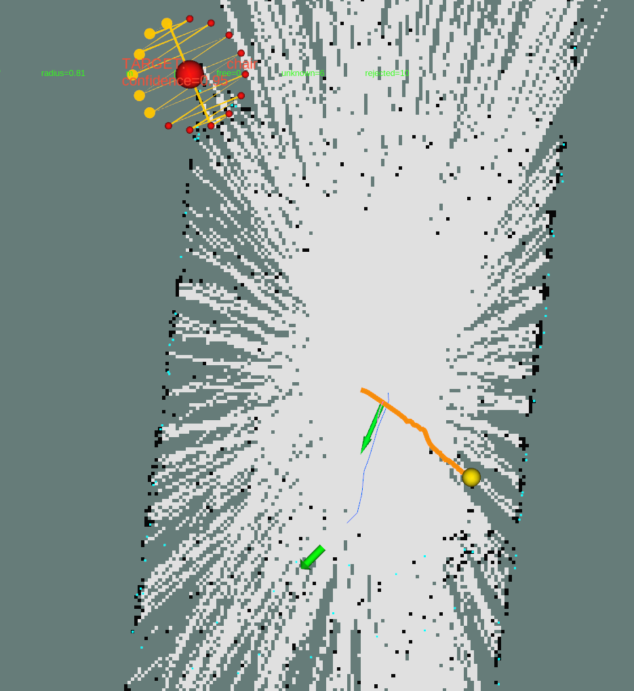

  - key: last_failure_reason
    value: 'Nav2 cannot plan to any approach candidate; last rejection: approach_endpoint_status_occupied'

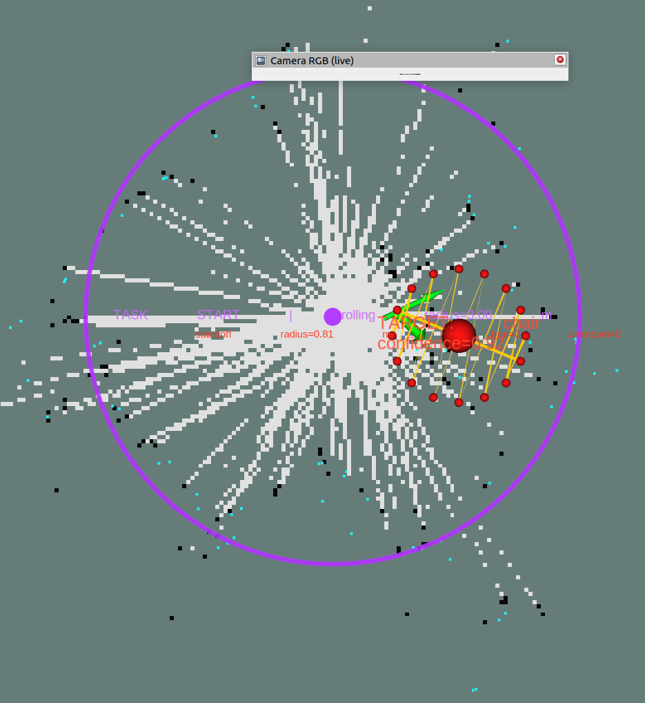

识别到了目标，但是朝向似乎有点偏移

[vlm_navigator-15] [ERROR] [1785497998.764396347] [vlm_nav]: Target lost during approach
[vlm_navigator-15] [INFO] [1785497998.764904630] [vlm_nav]: State -> FAILED
[bt_navigator-7] [ERROR] [1785497998.794171133] [bt_navigator_navigate_to_pose_rclcpp_node]: Failed to get result for follow_path in node halt!

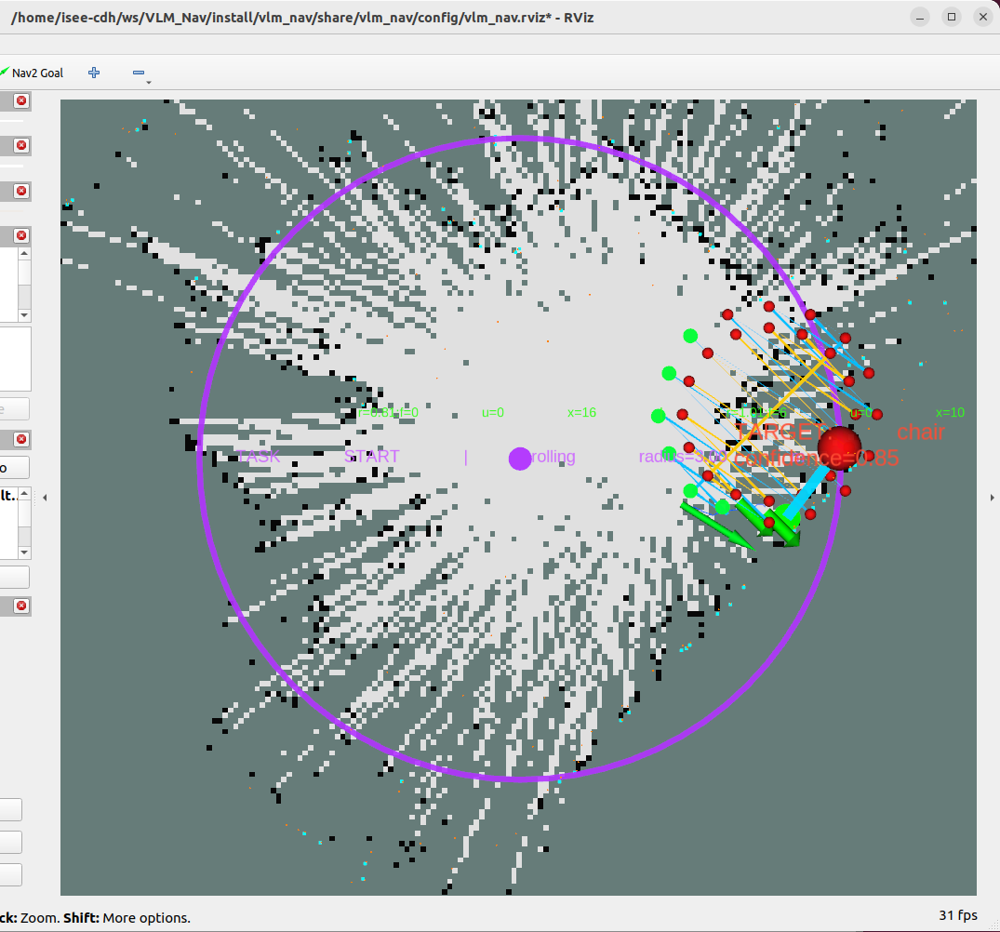

识别到了目标，但迟迟不动

[controller_server-3] [ERROR] [1785498461.663034594] [tf_help]: Transform data too old when converting from map to odom
[controller_server-3] [ERROR] [1785498461.663124627] [tf_help]: Data time: 1785498461s 635379922ns, Transform time: 1785498459s 399152803ns
[controller_server-3] [INFO] [1785498461.663183815] [controller_server]: Reached the goal!
[bt_navigator-7] [INFO] [1785498461.695202287] [bt_navigator]: Goal succeeded
[vlm_navigator-15] [ERROR] [1785498461.975926565] [vlm_nav]: Target lost during approach

诊断终端：

  - key: camera_status
    value: degraded; ready_age_s=164.942; error=Lookup would require extrapolation into the future.  Requested time 1785498459.804362 but t...
  - key: robot_tf_age_s
    value: '163.6'
  - key: scan_status
    value: inactive
  - key: vlm_status
    value: rejected_state_failed; latency_s=2.076; result_age_s=4.283; worker=idle
  - key: target_status
    value: grounded; map_xyz=(-0.953,-2.066,0.770)
  - key: navigation_status
    value: idle; last_plan=approach; status=4
  - key: standoff_status
    value: rings=0.81:f0/u16/x0,1.01:f0/u15/x1; selected=none
  - key: sensor_wait_reason
    value: none
  - key: last_api_error
    value: 'APITimeoutError: Request timed out.'

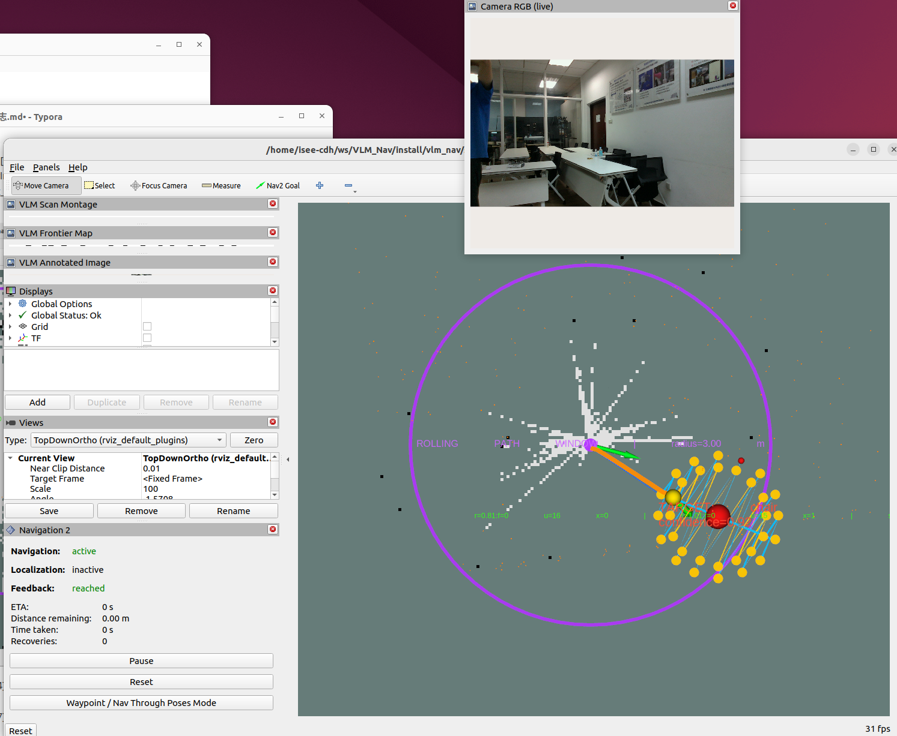

# 8.18

往前走了一段之后，一直在confirming, 距离椅子50cm左右，没有报错信息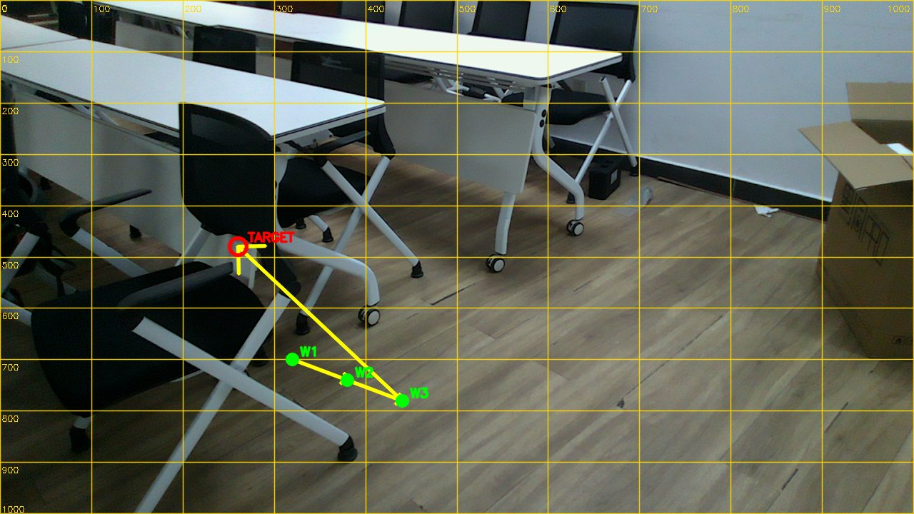

估计是因为VLM指到椅子的空里面导致深度跳变了。


此次设置目标为纸箱，小车旋转了半周后是失败：

```txt
value: failed; scan goal failed with status 6
```

本次实时障碍点云中，车体右前方存在最近点：

  base_link: x=+0.176 m, y=-0.534 m, z=0.646 m
  距车体中心约 0.563 m， 膨胀后判定为可能碰撞，因此终止。

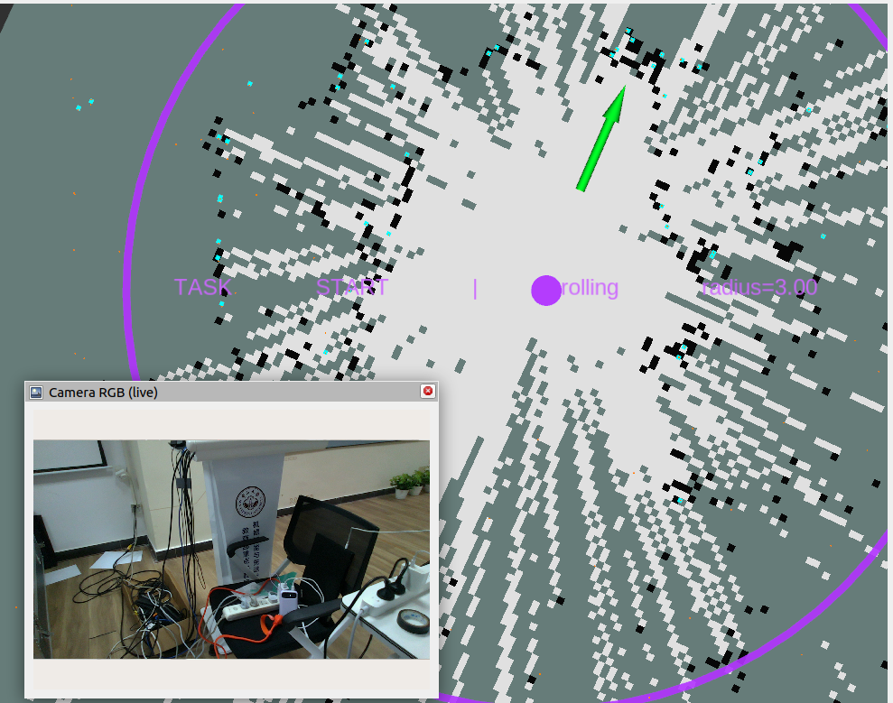

这次使用纸箱作为目标，成功了

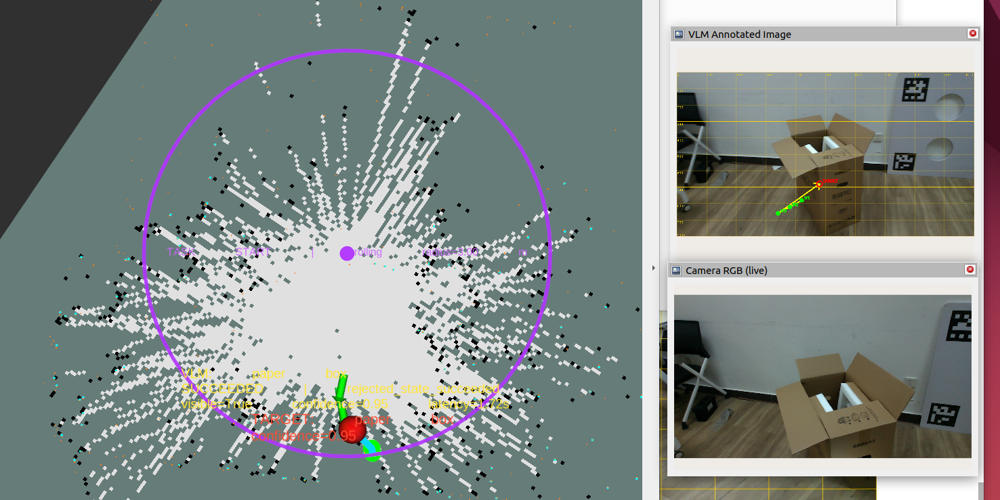

```TXT
key: last_failure_reason
    value: 'Nav2 cannot plan to any waypoint candidate; last rejection: planner_action_status_6'
```


# 8.19

今天进行有干扰项的实验，目标为"放置了可乐的椅子"。而干扰项是放了水壶的椅子。

有一次运行启动脚本到VLM请求验证处卡住1分钟无响应。

有一次走到椅子的侧面才停下而不是在离起点最近的停靠点。

在尝试接近目标到约半米范围后处于approaching没有进
  一步行动，且rviz中显示状态在reached和active之间闪烁。

位置与目标距离0.201m, 距离小于 Nav2 的 xy_goal_tolerance=0.25 m，所以 Controller 收到目标后约 3.6
  ms 就判定 Reached the goal!，不会驱动车轮。随后上层仍未满足 0.86 m 的目标距离
  条件，又重新下发目标，造成 RViz 的 active/reached 闪烁。

```txt
 - key: state
    value: APPROACHING
    
[vlm_navigator-15] [INFO] [1787137285.554751316] [vlm_nav]: Selected normal standoff ring radius=0.81 m; success_limit=0.86 m
[bt_navigator-7] [INFO] [1787137285.556163478] [bt_navigator]: Begin navigating from current location (-0.76, -0.22) to (-0.96, -0.20)
[controller_server-3] [INFO] [1787137285.576724301] [controller_server]: Received a goal, begin computing control effort.
[controller_server-3] [INFO] [1787137285.580310231] [controller_server]: Reached the goal!
[bt_navigator-7] [INFO] [1787137285.616515855] [bt_navigator]: Goal succeeded
[controller_server-3] [WARN] [1787137285.620407120] [local_costmap.local_costmap]: Sensor origin at (-0.74, -0.25 -0.35) is out of map bounds (-3.70, -3.25, -0.10) to (2.28, 2.73, 1.45). The costmap cannot raytrace for it.
[controller_server-3] [WARN] [1787137285.720382949] [local_costmap.local_costmap]: Sensor origin at (-0.74, -0.25 -0.35) is out of map bounds (-3.70, -3.25, -0.10) to (2.28, 2.73, 1.45). The costmap cannot raytrace for it.
[controller_server-3] [WARN] [1787137285.820389203] [local_costmap.local_costmap]: Sensor origin at (-0.74, -0.24 -0.35) is out of map bounds (-3.70, -3.25, -0.10) to (2.28, 2.73, 1.45). The costmap cannot raytrace for it.
```

nav终端说是规划的代价地图超出了地图范围，不能探测到。sensor_frame: body已确认，不将base_link认作传感器原点。又将成功导航的判据统一，不再是据目标小于0.81m而是0.81加减0.05m的范围，且这个容差比nav2的容差更小，以免冲突。

又出现一次转向之后丢失目标的情况

```txt
key: last_failure_reason
    value: Target lost during approach
```

# 8.20

非常顺利的第一次成功

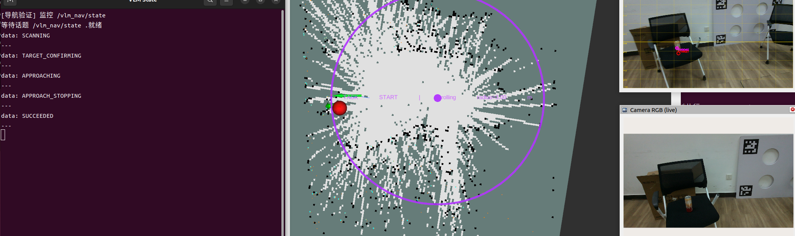

第二次是“放置了绿色盖子水壶的桌子“，一开始水壶在视野边缘，因而有时识别到有时识别不到，confirm时没有成功辨认；后来放到近处可以看清就成功了。提醒我们后面要增加探索功能。

第三次“放置了两包纸巾的椅子”

```txt
 key: last_failure_reason
    value: Target confirmation did not converge within 20.0s
```

```txt
key: last_failure_reason
    value: Target lost during approach
```

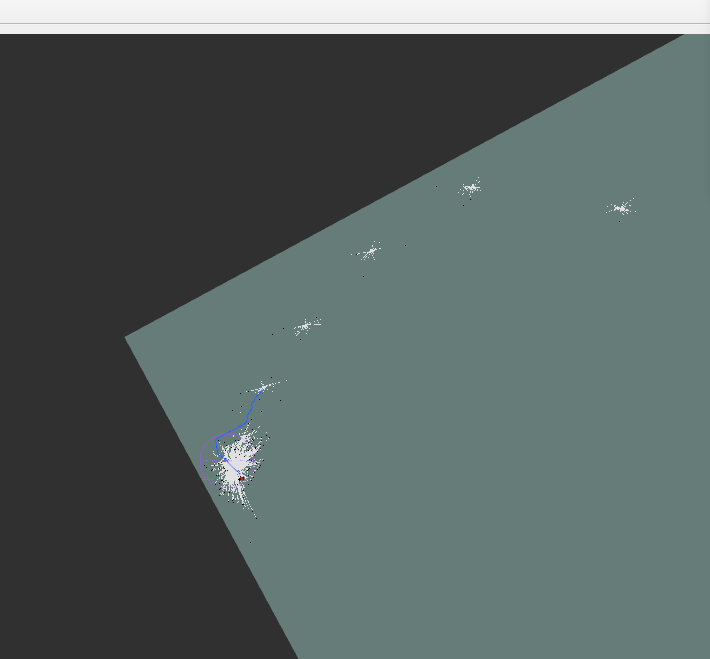

FAST_LIO已经严重发散，输出位置达到数十万米。最可能是主机或 Livox 时间戳在实验中向前跳了约 24 秒，导致 TF 清除旧时间段，同时 FAST_LIO 把异常时间间隔用于 IMU 积分并发散。应当测/odometry接近激光帧率再启动。

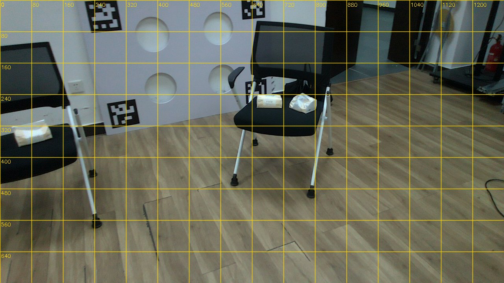

```txt
[WARN] [1787214006.670296656] [vlm_nav]: VLM failure 35/3: ValueError: pixel must contain exactly u and v
```

大模型回复了不被接受的多个值？有时被干扰项干扰了有时没有。有一次甚至被一瓶饮料和一个摄像头辨认为“放置了两包纸巾的椅子“。由于Qwen大模型输出的坐标只能是1000*1000,以免误导，既不在记录和发送给大模型的图中放置提示栅格了。

### 录制视频的7次成功了6次！！！

现在连续五次实验都成功了（三次室内，两次室外）目标都为“放置了可乐的椅子”。有一次是停在了0.81m的圈外，但是肉眼观察认为其实离得足够近了，视为成功。

到电梯前面试验两次，第一次转了五分钟成功，原因在于在等待大模型回复之前就转走了，于是转了很多圈一直没见到目标；第二次失败，原因为

```txt
 key: last_failure_reason
    value: 'Stationary scan result rejected repeatedly at heading 1/8: rejected_stale'

[vlm_nav]: Image-time camera TF pending: Lookup would require extrapolation into the future.  Requested time 1787225721.729701 but the latest data is at time 1787225721.103399, w
hen looking up transform from frame [camera_color_optical_frame] to frame [map]
```

latency_s 明显小于 4 秒，但 result_age_s 超过 4 秒：主要是图像提交前在 TF、采样定时器或工作队列里等待。

目前倾向于FAST_LIO /Odometry/动态 TF处理落后，SLAM 链路随后被连带拖慢；不是 VLM API 导致这条 TF 报错。

实际运行时测试

```bash
ros2 topic delay /camera/color/image_raw
ros2 topic delay /Odometry
ros2 topic hz /Odometry
ros2 topic hz /cloud_registered_body
ros2 run tf2_ros tf2_monitor map camera_color_optical_frame
```

判断方法：

  - 相机延迟接近 0，但 /Odometry 延迟约 0.6 s：FAST_LIO 计算积压，基本可以确认。
  - /Odometry 延迟正常，但 map→odom 延迟大：SLAM Toolbox 或 /scan 输入链路积压。
  - 相机显示负延迟或时间戳明显领先：RealSense/主机时钟基准问题。
  - /Odometry 频率持续低于正常约 10 Hz，并不断落后：FAST_LIO 没有实时运行。


# 10.06

启动导航链，未使能，新开终端：

```bash
cd /home/isee-cdh/ws/VLM_Nav
source scripts/common.sh

run_dir="$PWD/log/localization_runs/$(date +%Y%m%d_%H%M%S)_$$"
mkdir -p "$run_dir/parameters/start" "$run_dir/parameters/end"

git rev-parse HEAD > "$run_dir/commit.txt"
git status --short > "$run_dir/git_status.txt"
git diff > "$run_dir/worktree.diff"

snapshot_params() {
  local phase="$1"
  local node
  for node in \
    /amcl /map_server \
    /laser_mapping /fastlio_odom_adapter /ranger_base_node \
    /obstacle_cloud_filter /fastlio_cloud_to_scan \
    /controller_server /velocity_smoother /behavior_server \
    /local_costmap/local_costmap /global_costmap/global_costmap \
    /vlm_nav
  do
    timeout 5s ros2 param dump "$node" \
      > "$run_dir/parameters/$phase/${node//\//_}.yaml" \
      2> "$run_dir/parameters/$phase/${node//\//_}.stderr" ||
      printf '%s\n' "$node" >> "$run_dir/parameters/$phase/failed_nodes.txt"
  done
}

snapshot_params start
ros2 node list > "$run_dir/nodes.txt"
ros2 topic list -t > "$run_dir/topics.txt"

for topic in /tf /tf_static /Odometry /fastlio/odom /odom /scan; do
  ros2 topic info -v "$topic" \
    > "$run_dir/${topic//\//_}_endpoints.txt" 2>&1
done

ros2 param get /amcl scan_topic
ros2 param get /amcl robot_model_type
ros2 param get /map_server yaml_filename
```

然后在这个终端录包：

```bash
# 目录不存在或变量为空时，中止，避免再次写入根目录。
if [[ -n "$run_dir" && -d "$run_dir/parameters/start" ]]; then
  cat > "$run_dir/qos.yaml" <<'YAML'
/map:
  reliability: reliable
  durability: transient_local
  history: keep_last
  depth: 1
/tf_static:
  reliability: reliable
  durability: transient_local
  history: keep_last
  depth: 100
YAML

  scan_topic=/scan

  ros2 bag record \
    --output "$run_dir/rosbag" \
    --qos-profile-overrides-path "$run_dir/qos.yaml" \
    /tf /tf_static \
    /Odometry /fastlio/odom /odom \
    "$scan_topic" \
    /amcl_pose /particle_cloud /initialpose /map \
    /cmd_vel /cmd_vel_nav \
    /local_costmap/costmap /local_costmap/costmap_updates \
    /local_costmap/costmap_raw /local_costmap/costmap_raw_updates \
    /local_costmap/published_footprint \
    /rosout /parameter_events
else
  echo "未找到实验目录，请重新执行创建实验目录和开始参数快照的步骤。"
fi
```

录包后正常执行一次导航，以供排查问题。

与codex交代：

```txt
只读分析本次 Ranger AMCL 跳变录包，不修改配置，不启动硬件或任务。

先检查核心话题是否完整、实际 AMCL 参数和地图是否归档成功。
按以下顺序分析，只输出能由数据支持的结论：

1. 找出最大的 3 次 map→odom 修正。
   对照同一 scan 时刻的 odom→base_link、/Odometry、
   /fastlio/odom 和 /odom，判断哪条链先发生变化。
   比较平移与经过角度归一化的 yaw。
   AMCL TF 可能被 transform_tolerance 延后，
   不把 map→odom.header.stamp 直接作为扫描更新时间。

2. 检查实际 scan 的 frame、时间连续性、无效比例和跳变前后形状。
   用故障前稳定的 map→odom 加 FAST-LIO 延续位姿，
   将跳变后的 scan 投到地图中；
   不仅用跳变后的 AMCL 位姿判断匹配是否正确。
   重点检查墙面/墙角与桌椅区域是否分别支持不同位置，
   留意 Go2 地图与 Ranger 激光高度切片不一致。

3. 确认实际运动模型和 alpha1–5。
   在关键更新处重算运动预测噪声，并对照粒子分布：
   是否先扩散，再被观测选到另一簇；
   原定位附近的粒子是否在重采样后丢失。
   若实际已使用 Omni，不预设 Differential 是根因。

4. 仅当出现 Nav2 碰撞 ABORT 时，
   再对照 local raw costmap、published_footprint 和故障位姿，
   判断碰撞是否发生在定位跳变之后。

交付：
- 一张最多 3 行的关键事件表；
- 最可能原因、支持证据、尚缺证据；
- 只建议一个下一步对照实验。
不做完整系统重审，不先调 footprint、inflation 或多项 AMCL 参数。
```

现在录包两次，总共测试四次，只有第一次急速跳变而失败，后面三次成功。在手动遥控时也出现了剧烈跳变的现象。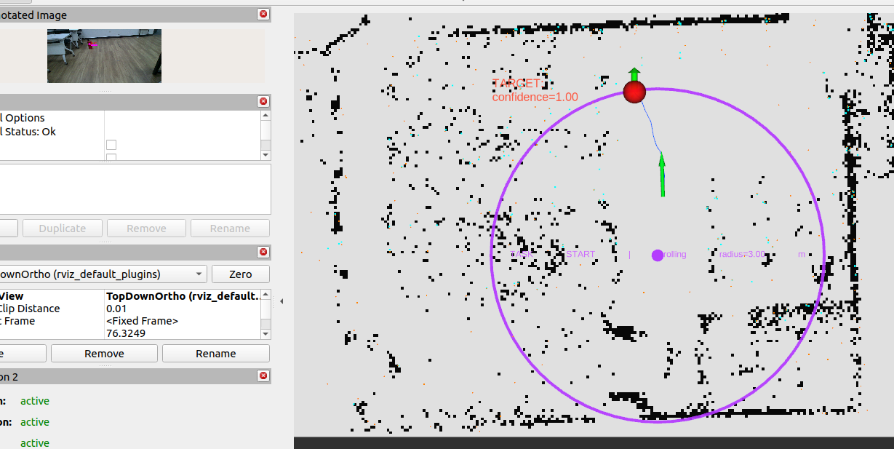
